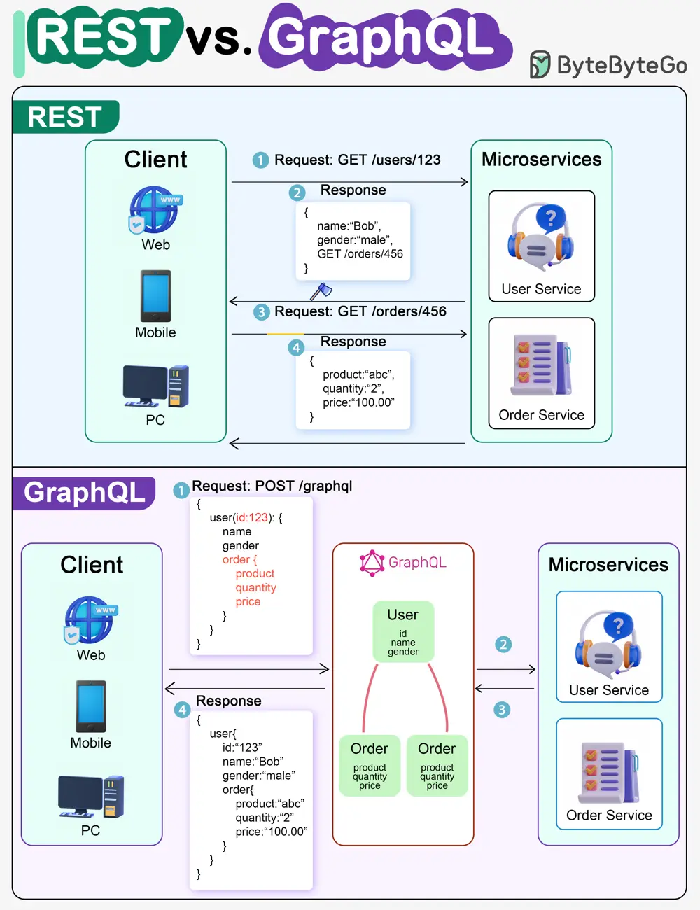

# ByteByteGo System Design 101: REST API vs. GraphQL

> Copied from <https://github.com/ByteByteGoHq/system-design-101> (CC BY-NC-ND 4.0, by ByteByteGo). Questions and answers are the source's own; nothing was answered or rewritten here.

When it comes to API design, REST and GraphQL each have their own strengths and weaknesses.

**REST**

*   Uses standard HTTP methods like GET, POST, PUT, DELETE for CRUD operations.
*   Works well when you need simple, uniform interfaces between separate services/applications.
*   Caching strategies are straightforward to implement.
*   The downside is it may require multiple roundtrips to assemble related data from separate endpoints.

**GraphQL**

*   Provides a single endpoint for clients to query for precisely the data they need.
*   Clients specify the exact fields required in nested queries, and the server returns optimized payloads containing just those fields.
*   Supports Mutations for modifying data and Subscriptions for real-time notifications.
*   Great for aggregating data from multiple sources and works well with rapidly evolving frontend requirements.
*   However, it shifts complexity to the client side and can allow abusive queries if not properly safeguarded.
*   Caching strategies can be more complicated than REST.

The best choice between REST and GraphQL depends on the specific requirements of the application and development team. GraphQL is a good fit for complex or frequently changing frontend needs, while REST suits applications where simple and consistent contracts are preferred.
