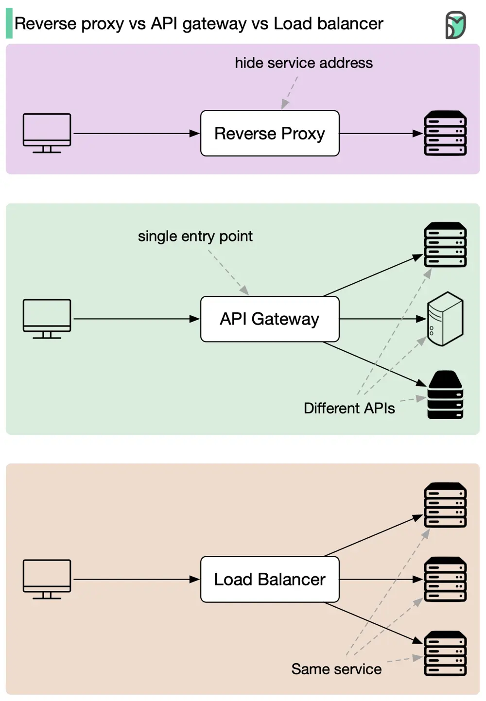

# ByteByteGo System Design 101: Reverse Proxy vs. API Gateway vs. Load Balancer

> Copied from <https://github.com/ByteByteGoHq/system-design-101> (CC BY-NC-ND 4.0, by ByteByteGo). Questions and answers are the source's own; nothing was answered or rewritten here.

As modern websites and applications are like busy beehives, we use a variety of tools to manage the buzz. Here we'll explore three superheroes: Reverse Proxy, API Gateway, and Load Balancer.

*   **Reverse Proxy:** change identity
    *   Fetching data secretly, keeping servers hidden.
    *   Perfect for shielding sensitive websites from cyber-attacks and prying eyes.
*   **API Gateway:** postman
    *   Delivers requests to the right services.
    *   Ideal for bustling applications with numerous intercommunicating services.
*   **Load Balancer:** traffic cop
    *   Directs traffic evenly across servers, preventing bottlenecks
    *   Essential for popular websites with heavy traffic and high demand.

In a nutshell, choose a Reverse Proxy for stealth, an API Gateway for organized communications, and a Load Balancer for traffic control. Sometimes, it's wise to have all three - they make a super team that keeps your digital kingdom safe and efficient.
