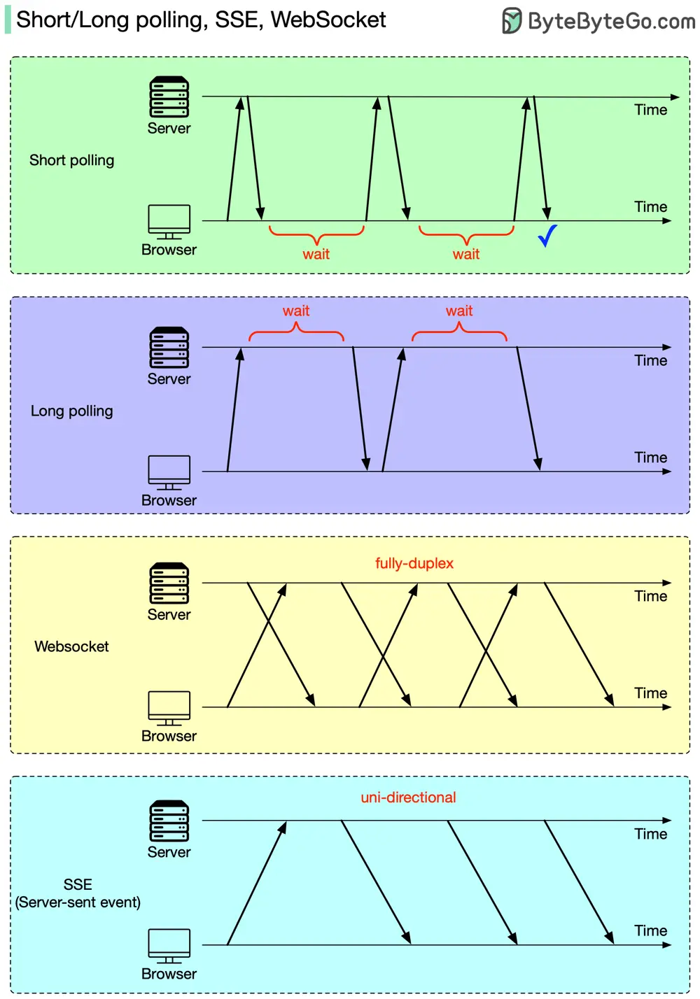

# ByteByteGo System Design 101: Short/long polling, SSE, WebSocket

> Copied from <https://github.com/ByteByteGoHq/system-design-101> (CC BY-NC-ND 4.0, by ByteByteGo). Questions and answers are the source's own; nothing was answered or rewritten here.

An HTTP server cannot automatically initiate a connection to a browser. As a result, the web browser is the initiator. What should we do next to get real-time updates from the HTTP server?

Both the web browser and the HTTP server could be responsible for this task.

*   **Web browsers do the heavy lifting**: short polling or long polling. With short polling, the browser will retry until it gets the latest data. With long polling, the HTTP server doesn’t return results until new data has arrived.
*   **HTTP server and web browser cooperate**: WebSocket or SSE (server-sent event). In both cases, the HTTP server could directly send the latest data to the browser after the connection is established. The difference is that SSE is uni-directional, so the browser cannot send a new request to the server, while WebSocket is fully-duplex, so the browser can keep sending new requests.
