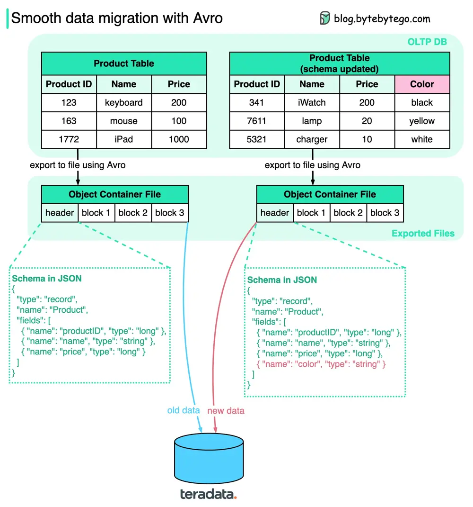

# ByteByteGo System Design 101: Smooth Data Migration with Avro

> Copied from <https://github.com/ByteByteGoHq/system-design-101> (CC BY-NC-ND 4.0, by ByteByteGo). Questions and answers are the source's own; nothing was answered or rewritten here.

How do we ensure when performing data migration? The diagram above shows how Apache Avro manages the schema evolution during data migration.

Avro was started in 2009, initially as a subproject of Apache Hadoop to address Thrift’s limitation in Hadoop use cases. Avro is mainly used for two things: Data serialization and RPC.

Key points in the diagram:

*   We can export the data to **object container files**, where schema sits together with the data blocks. Avro **dynamically** generates the schemas based on the columns, so if the schema is changed, a new schema is generated and stored with new data.

*   When the exported files are loaded into another data storage (for example, teradata), anyone can read the schema and know how to read the data. The old data and new data can be successfully migrated to the new database.
    Unlike gRPC or Thrift, which statically generate schemas, Avro makes the data migration process easier.
