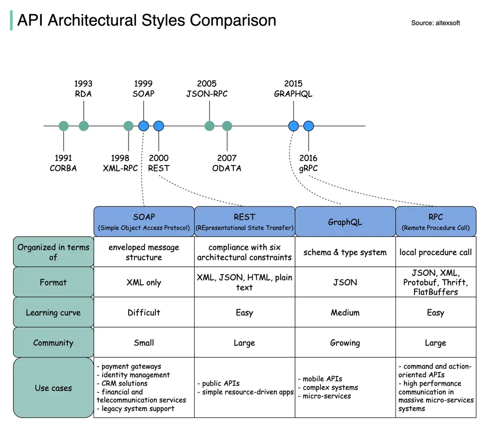

# ByteByteGo System Design 101: SOAP vs REST vs GraphQL vs RPC

> Copied from <https://github.com/ByteByteGoHq/system-design-101> (CC BY-NC-ND 4.0, by ByteByteGo). Questions and answers are the source's own; nothing was answered or rewritten here.

The diagram above illustrates the API timeline and API styles comparison.

Over time, different API architectural styles are released. Each of them has its own patterns of standardizing data exchange.

You can check out the use cases of each style in the diagram.
