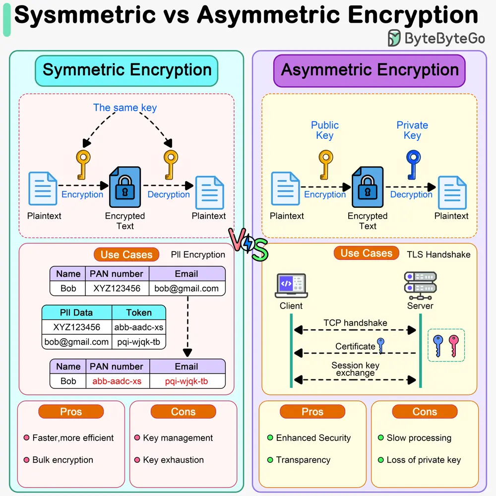

# ByteByteGo System Design 101: Symmetric vs Asymmetric Encryption

> Copied from <https://github.com/ByteByteGoHq/system-design-101> (CC BY-NC-ND 4.0, by ByteByteGo). Questions and answers are the source's own; nothing was answered or rewritten here.

Symmetric encryption and asymmetric encryption are two types of cryptographic techniques used to secure data and communications, but they differ in their methods of encryption and decryption.

*   In symmetric encryption, a single key is used for both encryption and decryption of data. It is faster and can be applied to bulk data encryption/decryption. For example, we can use it to encrypt massive amounts of PII (Personally Identifiable Information) data. It poses challenges in key management because the sender and receiver share the same key.

*   Asymmetric encryption uses a pair of keys: a public key and a private key. The public key is freely distributed and used to encrypt data, while the private key is kept secret and used to decrypt the data. It is more secure than symmetric encryption because the private key is never shared. However, asymmetric encryption is slower because of the complexity of key generation and maths computations. For example, HTTPS uses asymmetric encryption to exchange session keys during TLS handshake, and after that, HTTPS uses symmetric encryption for subsequent communications.
