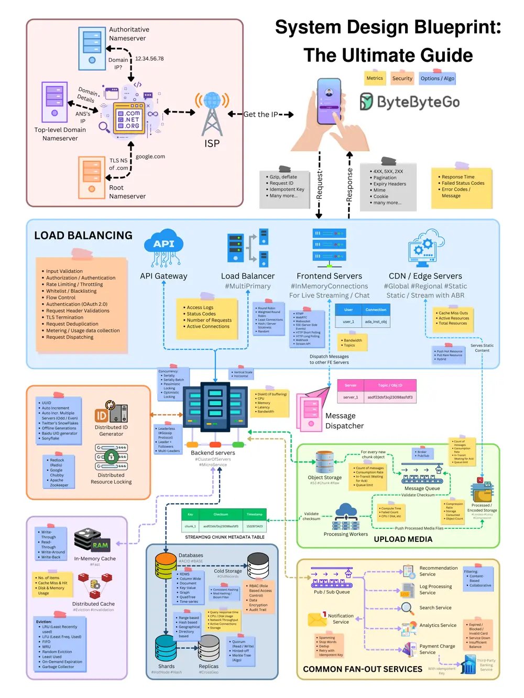

# ByteByteGo System Design 101: System Design Blueprint: The Ultimate Guide

> Copied from <https://github.com/ByteByteGoHq/system-design-101> (CC BY-NC-ND 4.0, by ByteByteGo). Questions and answers are the source's own; nothing was answered or rewritten here.

We've created a template to tackle various system design problems in interviews.

Hope this checklist is useful to guide your discussions during the interview process.

This briefly touches on the following discussion points:

*   Load Balancing
*   API Gateway
*   Communication Protocols
*   Content Delivery Network (CDN)
*   Database
*   Cache
*   Message Queue
*   Unique ID Generation
*   Scalability
*   Availability
*   Performance
*   Security
*   Fault Tolerance and Resilience
*   And more
