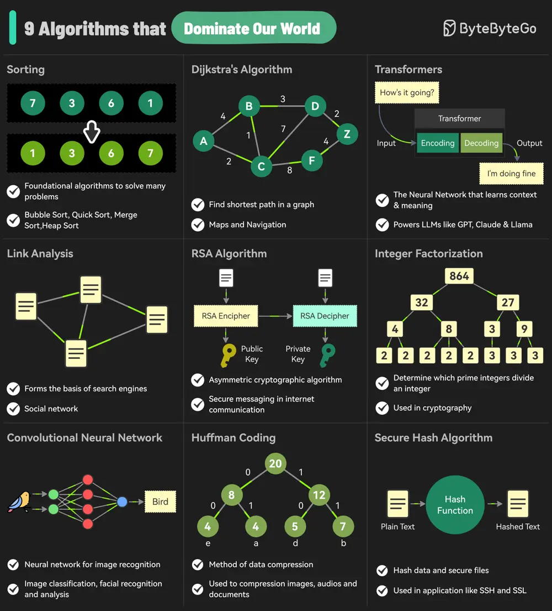

# ByteByteGo System Design 101: The 9 Algorithms That Dominate Our World

> Copied from <https://github.com/ByteByteGoHq/system-design-101> (CC BY-NC-ND 4.0, by ByteByteGo). Questions and answers are the source's own; nothing was answered or rewritten here.

The diagram below shows the most commonly used algorithms in our daily lives. They are used in internet search engines, social networks, WiFi, cell phones, and even satellites.

## 1. Sorting

## 2. Dijkstra’s Algorithm

## 3. Transformers

## 4. Link Analysis

## 5. RSA Algorithm

## 6. Integer Factorization

## 7. Convolutional Neural Networks

## 8. Huffman Coding

## 9. Secure Hash Algorithm
