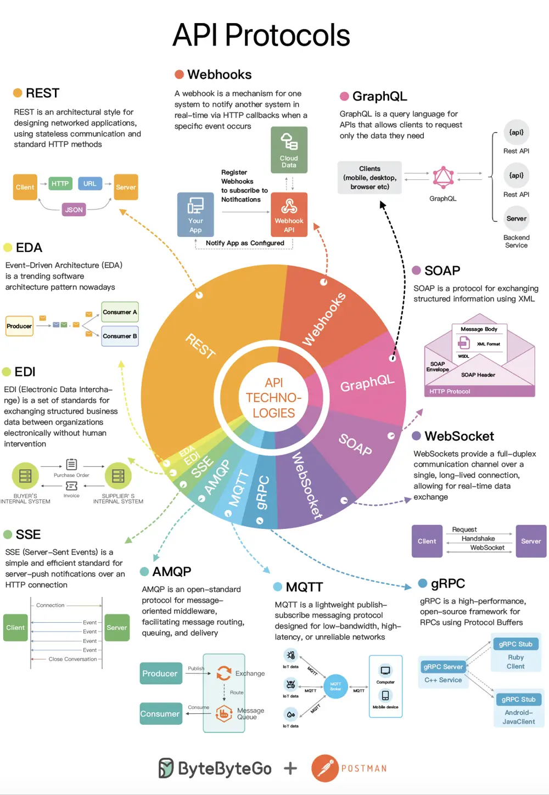

# ByteByteGo System Design 101: The Evolving Landscape of API Protocols in 2023

> Copied from <https://github.com/ByteByteGoHq/system-design-101> (CC BY-NC-ND 4.0, by ByteByteGo). Questions and answers are the source's own; nothing was answered or rewritten here.

This is a brief summary of the blog post I wrote for Postman.

In this blog post, I cover the six most popular API protocols: REST, Webhooks, GraphQL, SOAP, WebSocket, and gRPC. The discussion includes the benefits and challenges associated with each protocol.

You can read the [full blog post here](https://blog.postman.com/api-protocols-in-2023/).
