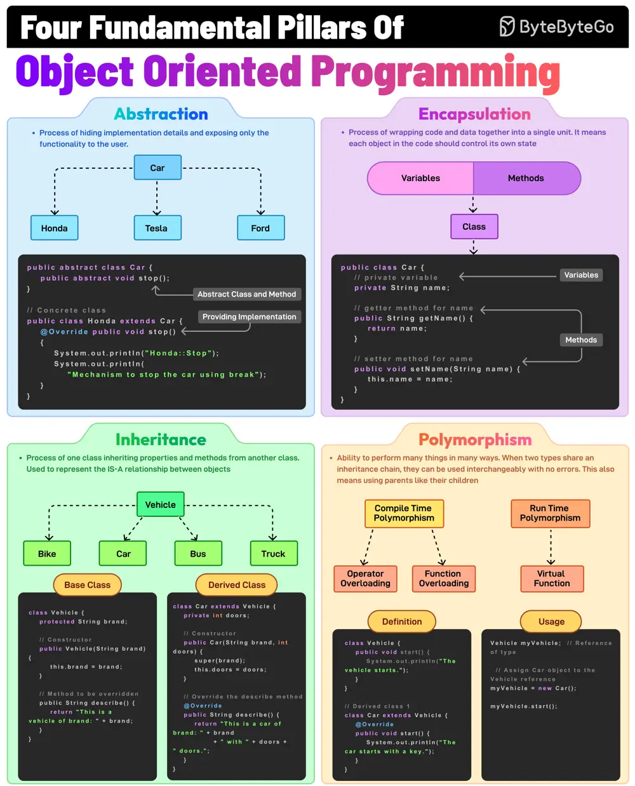

# ByteByteGo System Design 101: The Fundamental Pillars of Object-Oriented Programming

> Copied from <https://github.com/ByteByteGoHq/system-design-101> (CC BY-NC-ND 4.0, by ByteByteGo). Questions and answers are the source's own; nothing was answered or rewritten here.

Abstraction, Encapsulation, Inheritance, and Polymorphism are the four pillars of object-oriented programming. What do they mean?

## Abstraction

This is the process of hiding implementation details and showing only the essential features of an object. For example, a Vehicle class with an abstract stop method.

## Encapsulation

It involves wrapping data (fields) and methods in a single unit (class) and restricting direct access using access modifiers. For example, private fields with public getters and setters.

## Inheritance

The process of creating a new class (child) that inherits attributes and methods from an existing class (parent), thereby promoting code reuse. For example, a Car class inherits from a Vehicle class.

## Polymorphism

It allows methods to perform differently based on the object they are invoked on. When two types share an inheritance chain, they can be used interchangeably with no errors.
