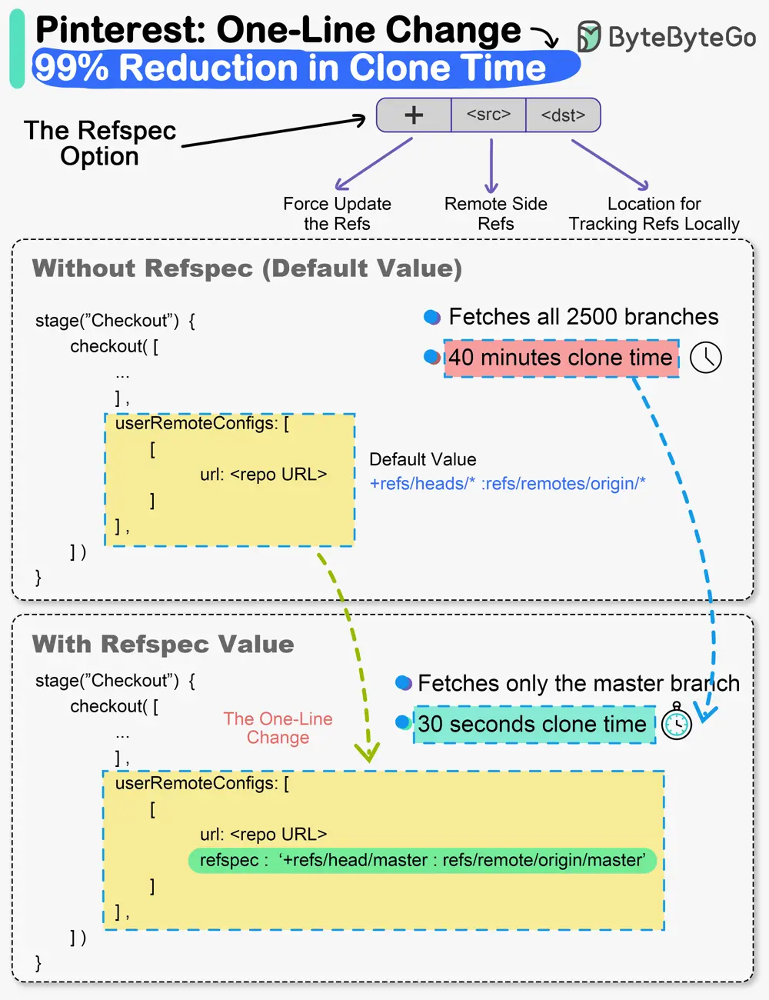

# ByteByteGo System Design 101: The one-line change that reduced clone times by 99% at Pinterest

> Copied from <https://github.com/ByteByteGoHq/system-design-101> (CC BY-NC-ND 4.0, by ByteByteGo). Questions and answers are the source's own; nothing was answered or rewritten here.

While it may sound cliché, small changes can definitely create a big impact.

The Engineering Productivity team at Pinterest witnessed this first-hand.

They made a small change in the Jenkins build pipeline of their monorepo codebase called Pinboard.

And it brought down clone times from 40 minutes to a staggering 30 seconds.

For reference, Pinboard is the oldest and largest monorepo at Pinterest. Some facts about it:

*   **350K commits**
*   **20 GB in size when cloned fully**
*   **60K git pulls on every business day**

Cloning monorepos having a lot of code and history is time consuming. This was exactly what was happening with Pinboard.

The build pipeline (written in Groovy) started with a “Checkout” stage where the repository was cloned for the build and test steps.

The clone options were set to shallow clone, no fetching of tags and only fetching the last 50 commits.

But it missed a vital piece of optimization.

The Checkout step didn’t use the Git refspec option.

This meant that Git was effectively fetching all refspecs for every build. For the Pinboard monorepo, it meant fetching more than 2500 branches.

𝐒𝐨 - 𝐰𝐡𝐚𝐭 𝐰𝐚𝐬 𝐭𝐡𝐞 𝐟𝐢𝐱?

The team simply added the refspec option and specified which ref they cared about. It was the “master” branch in this case.

This single change allowed Git clone to deal with only one branch and significantly reduced the overall build time of the monorepo.
