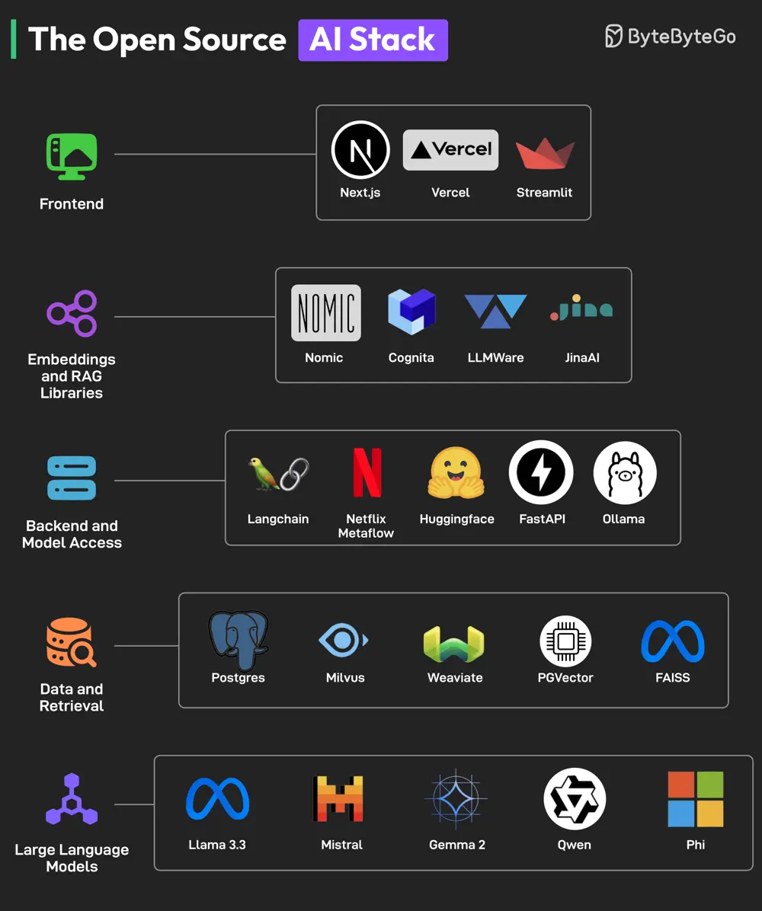

# ByteByteGo System Design 101: The Open Source AI Stack

> Copied from <https://github.com/ByteByteGoHq/system-design-101> (CC BY-NC-ND 4.0, by ByteByteGo). Questions and answers are the source's own; nothing was answered or rewritten here.

You don’t need to spend a fortune to build an AI application. The best AI developer tools are open-source, and an excellent ecosystem is evolving that can make AI accessible to everyone.

The key components of this open-source AI stack are as follows:

## Frontend

To build beautiful AI UIs, frameworks like NextJS and Streamlit are extremely useful. Also, Vercel can help with deployment.

## Embeddings and RAG libraries

Embedding models and RAG libraries like Nomic, JinaAI, Cognito, and LLMAware help developers build accurate search and RAG features.

## Backend and Model Access

For backend development, developers can rely on frameworks like FastAPI, Langchain, and Netflix Metaflow. Options like Ollama and Huggingface are available 
for model access.
## Data and Retrieval

For data storage and retrieval, several options like Postgres, Milvus, Weaviate, PGVector, and FAISS are available.

## Large-Language Models

Based on performance benchmarks, open-source models like Llama, Mistral, Qwen, Phi, and Gemma are great alternatives to proprietary LLMs like GPT and Claude.

