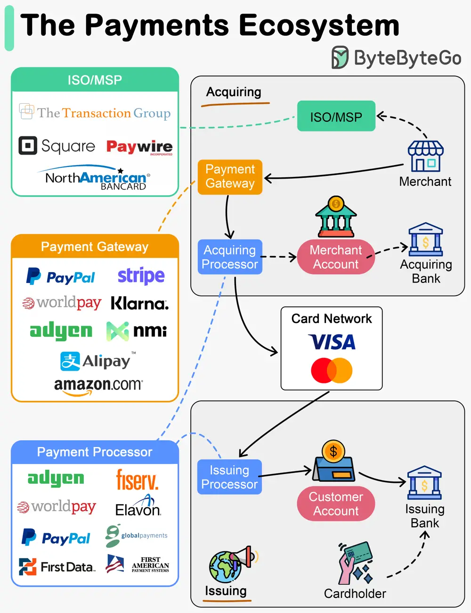

# ByteByteGo System Design 101: The Payments Ecosystem

> Copied from <https://github.com/ByteByteGoHq/system-design-101> (CC BY-NC-ND 4.0, by ByteByteGo). Questions and answers are the source's own; nothing was answered or rewritten here.

How do fintech startups find new opportunities among so many payment companies? What do PayPal, Stripe, and Square do exactly?!

## Steps 0-1

The cardholder opens an account in the issuing bank and gets the debit/credit card. The merchant registers with ISO (Independent Sales Organization) or MSP (Member Service Provider) for in-store sales. ISO/MSP partners with payment processors to open merchant accounts.

## Steps 2-5

The acquiring process.

The payment gateway accepts the purchase transaction and collects payment information. It is then sent to a payment processor, which uses customer information to collect payments. The acquiring processor sends the transaction to the card network. It also owns and operates the merchant’s account during settlement, which doesn’t happen in real-time.

## Steps 6-8

The issuing process.

The issuing processor talks to the card network on the issuing bank’s behalf. It validates and operates the customer’s account.

I’ve listed some companies in different verticals in the diagram. Notice payment companies usually start from one vertical, but later expand to multiple verticals.
