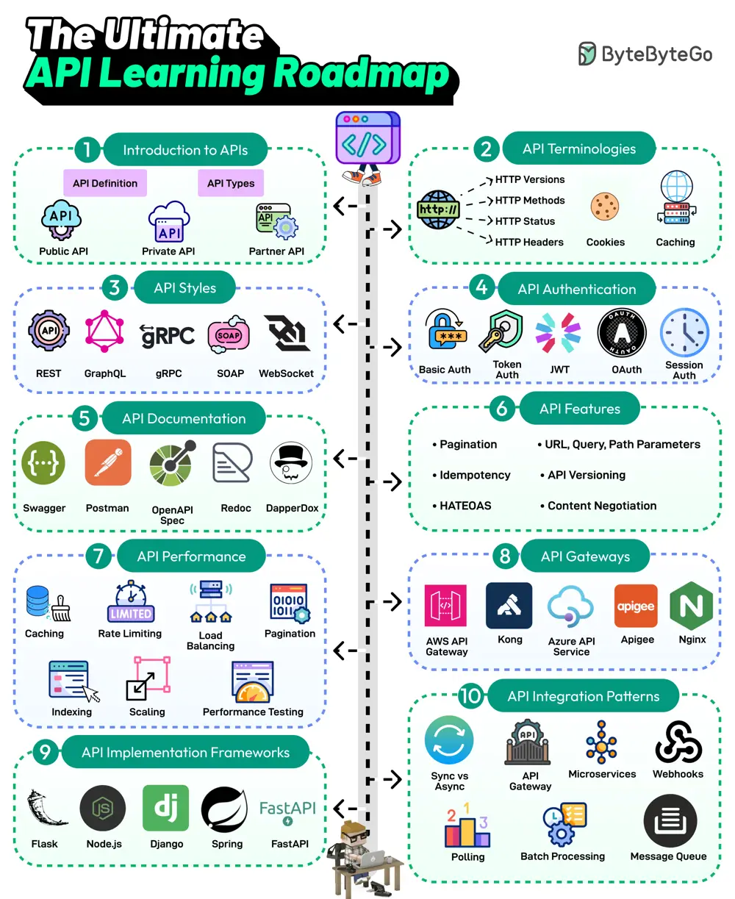

# ByteByteGo System Design 101: The Ultimate API Learning Roadmap

> Copied from <https://github.com/ByteByteGoHq/system-design-101> (CC BY-NC-ND 4.0, by ByteByteGo). Questions and answers are the source's own; nothing was answered or rewritten here.

APIs are the backbone of communication over the Internet. Every developer needs to learn about APIs. Here’s a roadmap that covers the most important topics:

*   **Introduction to APIs**
    *   API is a set of protocols and tools for building applications. Different types of APIs exist, such as public, private, and partner.
*   **API Terminologies**
    *   Various API terminologies, such as HTTP versions, cookies, and caching, need to be understood.
*   **API Styles**
    *   The most common API styles are REST, SOAP, GraphQL, gRPC, and WebSockets
*   **API Authentication**
    *   API Authentication techniques like Basic Auth, Token, JWTs, OAuth, and Session Auth
*   **API Documentation**
    *   A good API is understandable. API Documentation tools like Swagger, Postman, Redoc, and DapperDox make it possible.
*   **API Features**
    *   Key API features include pagination, parameters, idempotency, API versioning, HATEOAS, and content negotiation
*   **API Performance Techniques**
    *   Common API performance techniques are caching, rate limiting, load balancing, pagination, DB indexing, scaling, and performance testing.
*   **API Gateways**
    *   Learn about API Gateways such as Amazon API Gateway, Azure API Services, Kong, Nginx, etc.
*   **API Implementation Frameworks**
    *   The most popular API development frameworks are Node.js, Spring, Flask, Django, and FastAPI
*   **API Integration Patterns**
    *   Learn about various API integration patterns such as gateways, event-driven, webhook, polling, and batch processing.
