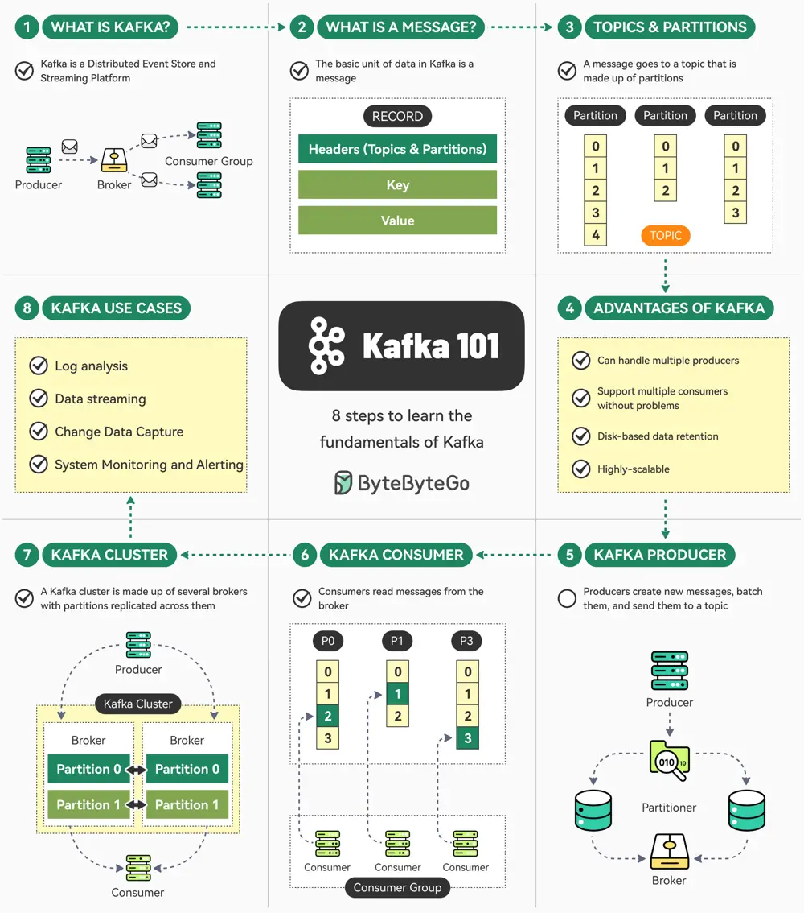

# ByteByteGo System Design 101: The Ultimate Kafka 101 You Cannot Miss

> Copied from <https://github.com/ByteByteGoHq/system-design-101> (CC BY-NC-ND 4.0, by ByteByteGo). Questions and answers are the source's own; nothing was answered or rewritten here.

Kafka is super-popular but can be overwhelming in the beginning.

Here are 8 simple steps that can help you understand the fundamentals of Kafka.

## What is Kafka?

Kafka is a distributed event store and a streaming platform. It began as an internal project at LinkedIn and now powers some of the largest data pipelines in the world in orgs like Netflix, Uber, etc.

## Kafka Messages

Message is the basic unit of data in Kafka. It’s like a record in a table consisting of headers, key, and value.

## Kafka Topics and Partitions

Every message goes to a particular Topic. Think of the topic as a folder on your computer. Topics also have multiple partitions.

## Advantages of Kafka

Kafka can handle multiple producers and consumers, while providing disk-based data retention and high scalability.

## Kafka Producer

Producers in Kafka create new messages, batch them, and send them to a Kafka topic. They also take care of balancing messages across different partitions.

## Kafka Consumer

Kafka consumers work together as a consumer group to read messages from the broker.

## Kafka Cluster

A Kafka cluster consists of several brokers where each partition is replicated across multiple brokers to ensure high availability and redundancy.

## Use Cases of Kafka

Kafka can be used for log analysis, data streaming, change data capture, and system monitoring.
