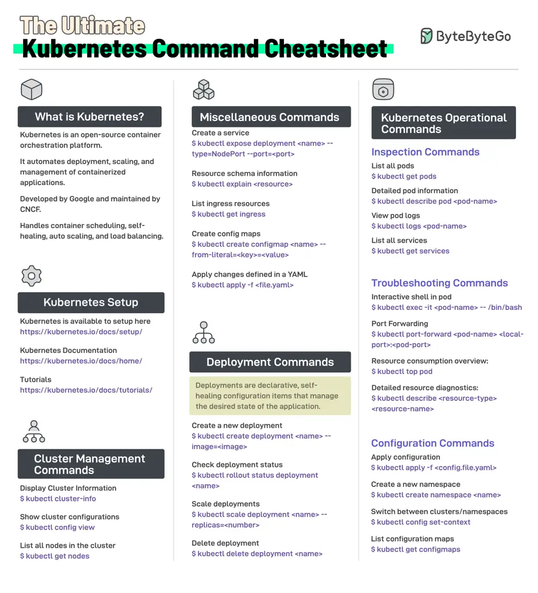

# ByteByteGo System Design 101: Kubernetes Command Cheatsheet

> Copied from <https://github.com/ByteByteGoHq/system-design-101> (CC BY-NC-ND 4.0, by ByteByteGo). Questions and answers are the source's own; nothing was answered or rewritten here.

Kubernetes is an open-source container orchestration platform. It automates the deployment, scaling, and management of containerized applications.

Initially developed by Google, Kubernetes is now maintained by CNCF (Cloud Native Computing Foundation).

This cheat sheet contains the most important Kubernetes commands for different purposes:

*   Kubernetes Setup

*   General Cluster Management

*   Kubernetes Deployments

*   Kubernetes Pod Inspection

*   Troubleshooting and Configuration

*   Miscellaneous commands related to services, config maps, and managing ingresses.
