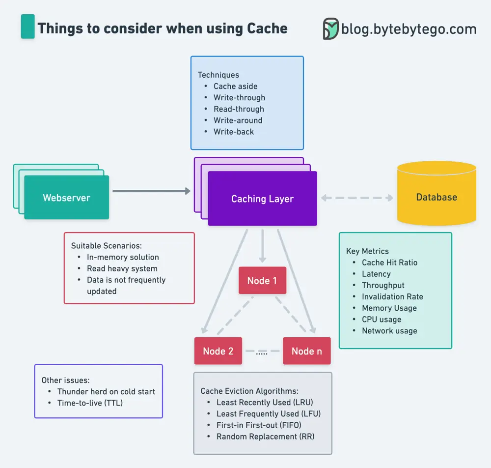

# ByteByteGo System Design 101: Things to Consider When Using Cache

> Copied from <https://github.com/ByteByteGoHq/system-design-101> (CC BY-NC-ND 4.0, by ByteByteGo). Questions and answers are the source's own; nothing was answered or rewritten here.

Caching is one of the 𝐦𝐨𝐬𝐭 𝐜𝐨𝐦𝐦𝐨𝐧𝐥𝐲 used techniques when building fast online systems. When using a cache, here are the top 5 things to consider:

The first version of the cheatsheet was written by guest author [Love Sharma](https://twitter.com/Zonito87).

## Suitable Scenarios

*   In-memory solution

*   Read heavy system

*   Data is not frequently updated

## Caching Techniques

*   Cache aside

*   Write-through

*   Read-through

*   Write-around

*   Write-back

## Cache Eviction Algorithms

*   Least Recently Used (LRU)

*   Least Frequently Used (LFU)

*   First-in First-out (FIFO)

*   Random Replacement (RR)

## Key Metrics

*   Cache Hit Ratio

*   Latency

*   Throughput

*   Invalidation Rate

*   Memory Usage

*   CPU usage

*   Network usage

## Other Issues

*   Thunder herd on cold start

*   Time-to-live (TTL)
