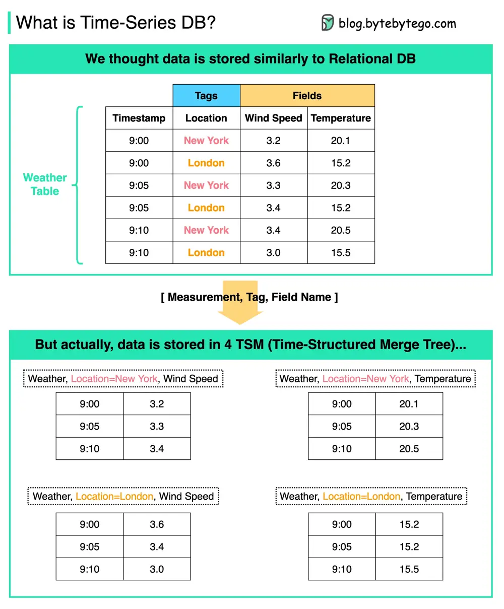

# ByteByteGo System Design 101: Time Series DB (TSDB) in 20 Lines

> Copied from <https://github.com/ByteByteGoHq/system-design-101> (CC BY-NC-ND 4.0, by ByteByteGo). Questions and answers are the source's own; nothing was answered or rewritten here.

What is **Time-Series DB** (TSDB)? How is it different from Relational DB?

The diagram above shows the **internal data model** of a typical Time-Series DB.

A TSDB is a database optimized for time series data.

*   From the users’ perspective, the data looks similar to the relational DB table. But behind the scenes, the weather table is stored in 4 TSMs (Time-Structured Merge Trees) in the format of \[Measurement, Tag, Field Name].

*   In this way, we can quickly aggregate and analyze data based on time and tags.

*   Typical usage:

    *   Trades and market data updates in a market
    *   Server metrics
    *   Application performance monitoring
    *   Network data
    *   Sensor data
    *   Events
    *   Clicks streams
