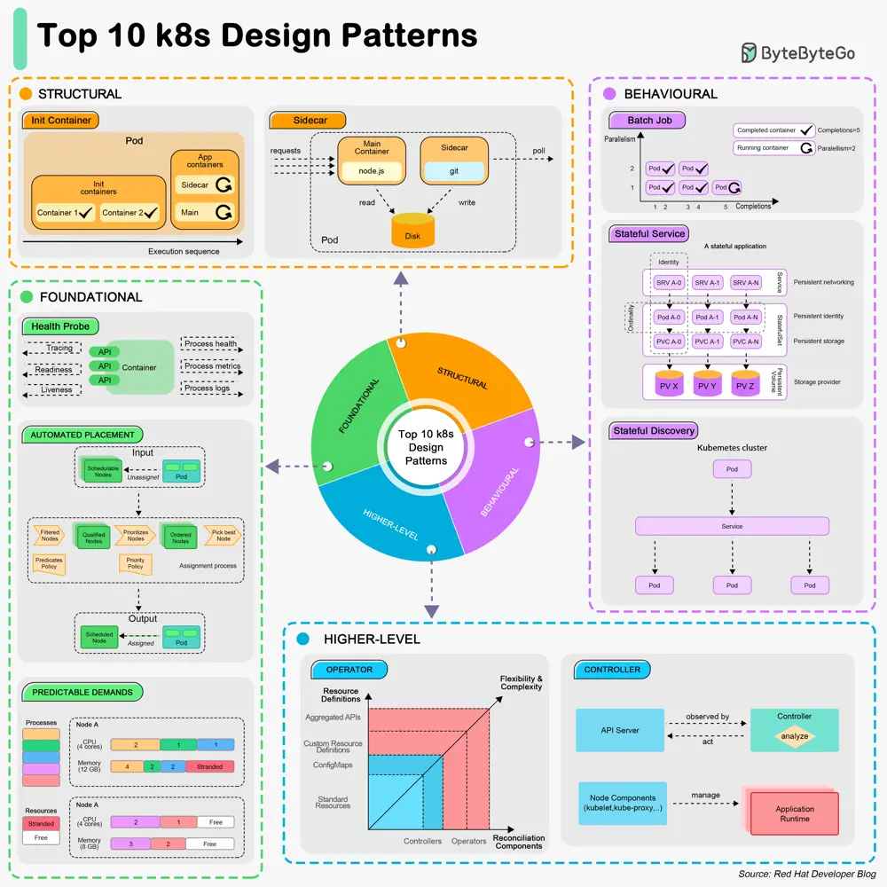

# ByteByteGo System Design 101: Top 10 Kubernetes Design Patterns

> Copied from <https://github.com/ByteByteGoHq/system-design-101> (CC BY-NC-ND 4.0, by ByteByteGo). Questions and answers are the source's own; nothing was answered or rewritten here.

## Foundational Patterns

These patterns are the fundamental principles for applications to be automated on k8s, regardless of the application's nature.

*   **Health Probe Pattern**

    This pattern requires that every container must implement observable APIs for the platform to manage the application.

*   **Predictable Demands Pattern**

    This pattern requires that we should declare application requirements and runtime dependencies. Every container should declare its resource profile.

*   **Automated Placement Pattern**

    This pattern describes the principles of Kubernetes’ scheduling algorithm.

## Structural Patterns

These patterns focus on structuring and organizing containers in a Pod.

*   **Init Container Pattern**

    This pattern has a separate life cycle for initialization-releated tasks.

*   **Sidecar Pattern**

    This pattern extends a container’s functionalities without changing it.

## Behavioral Patterns

These patterns describe the life cycle management of a Pod. Depending on the type of the workload, it can run as a service or a batch job.

*   **Batch Job Pattern**

    This pattern is used to manage isolated atomic units of work.

*   **Stateful Service Pattern**

    This pattern creates distributed stateful applications.

*   **Service Discovery Pattern**

    This pattern describes how clients discover the services.

## Higher-Level Patterns

These patterns focus on higher-level application management.

*   **Controller Pattern**

    This pattern monitors the current state and reconciles with the declared target state.

*   **Operator Pattern**

    This pattern defines operational knowledge in an algorithmic and automated form.
