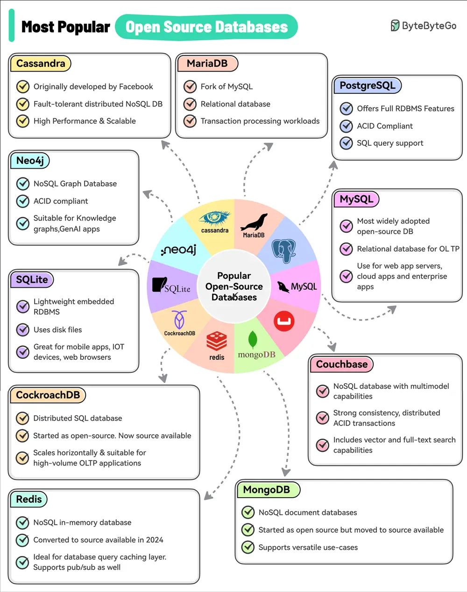

# ByteByteGo System Design 101: Top 10 Most Popular Open-Source Databases

> Copied from <https://github.com/ByteByteGoHq/system-design-101> (CC BY-NC-ND 4.0, by ByteByteGo). Questions and answers are the source's own; nothing was answered or rewritten here.

This list is based on factors like adoption, industry impact, and the general awareness of the database among the developer community.

## Top 10 Most Popular Open-Source Databases

*   MySQL
*   PostgreSQL
*   MariaDB
*   Apache Cassandra
*   Neo4j
*   SQLite
*   CockroachDB
*   Redis
*   MongoDB
*   Couchbase
