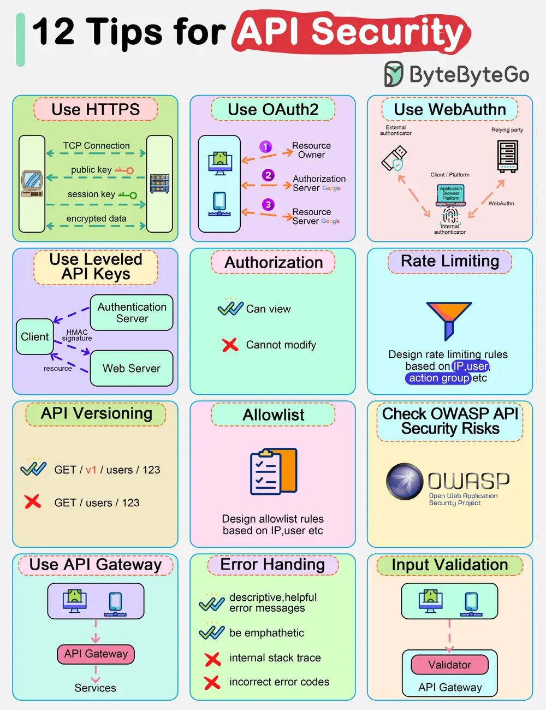

# ByteByteGo System Design 101: Top 12 Tips for API Security

> Copied from <https://github.com/ByteByteGoHq/system-design-101> (CC BY-NC-ND 4.0, by ByteByteGo). Questions and answers are the source's own; nothing was answered or rewritten here.

*   Use HTTPS
*   Use OAuth2
*   Use WebAuthn
*   Use Leveled API Keys
*   Authorization
*   Rate Limiting
*   API Versioning
*   Whitelisting
*   Check OWASP API Security Risks
*   Use API Gateway
*   Error Handling
*   Input Validation
