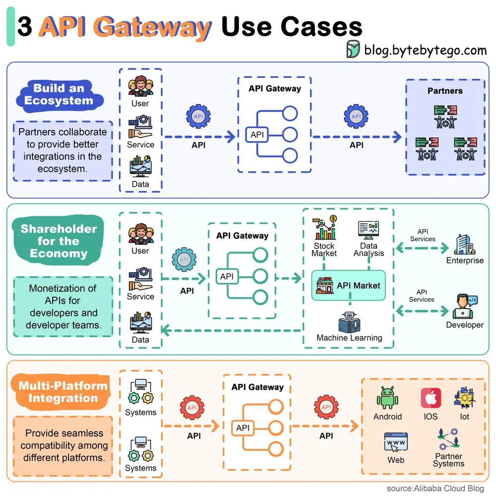

# ByteByteGo System Design 101: Top 3 API Gateway Use Cases

> Copied from <https://github.com/ByteByteGoHq/system-design-101> (CC BY-NC-ND 4.0, by ByteByteGo). Questions and answers are the source's own; nothing was answered or rewritten here.

API gateway sits between the clients and services, providing API communications between them.

*   **API gateway helps build an ecosystem.**
    The users can leverage an API gateway to access a wider set of tools. The partners in the ecosystem collaborate with each other to provide better integrations for the users.
*   **API gateway builds API marketplace**
    The API marketplace hosts fundamental functionalities for everyone. The developers and businesses can easily develop or innovate in this ecosystem and sell APIs on the marketplace.
*   **API gateway provides compatibility with multiple platforms**
    When dealing with multiple platforms, an API gateway can help work across multiple complex architectures.
