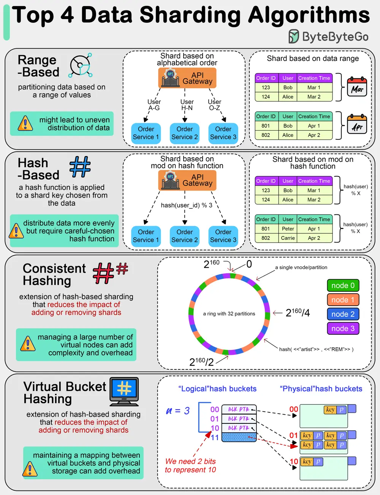

# ByteByteGo System Design 101: Top 4 Data Sharding Algorithms Explained

> Copied from <https://github.com/ByteByteGoHq/system-design-101> (CC BY-NC-ND 4.0, by ByteByteGo). Questions and answers are the source's own; nothing was answered or rewritten here.

We are dealing with massive amounts of data. Often we need to split data into smaller, more manageable pieces, or “shards”. Here are some of the top data sharding algorithms commonly used:

## Range-Based Sharding

This involves partitioning data based on a range of values. For example, customer data can be sharded based on alphabetical order of last names, or transaction data can be sharded based on date ranges.

## Hash-Based Sharding

In this method, a hash function is applied to a shard key chosen from the data (like a customer ID or transaction ID).

This tends to distribute data more evenly across shards compared to range-based sharding. However, we need to choose a proper hash function to avoid hash collisions.

## Consistent Hashing

This is an extension of hash-based sharding that reduces the impact of adding or removing shards. It distributes data more evenly and minimizes the amount of data that needs to be relocated when shards are added or removed.

## Virtual Bucket Sharding

Data is mapped into virtual buckets, and these buckets are then mapped to physical shards. This two-level mapping allows for more flexible shard management and rebalancing without significant data movement.
