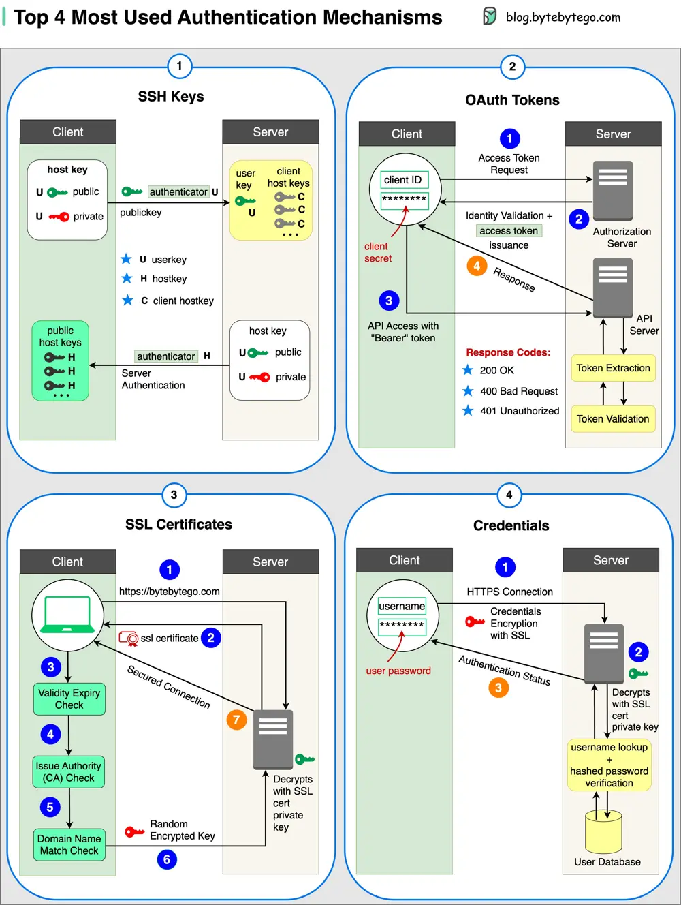

# ByteByteGo System Design 101: Top 4 Authentication Mechanisms

> Copied from <https://github.com/ByteByteGoHq/system-design-101> (CC BY-NC-ND 4.0, by ByteByteGo). Questions and answers are the source's own; nothing was answered or rewritten here.

## 1. SSH Keys

Cryptographic keys are used to access remote systems and servers securely.

## 2. OAuth Tokens

Tokens that provide limited access to user data on third-party applications.

## 3. SSL Certificates

Digital certificates ensure secure and encrypted communication between servers and clients.

## 4. Credentials

User authentication information is used to verify and grant access to various systems and services.

Over to you: How do you manage those security keys? Is it a good idea to put them in a GitHub repository?

Guest post by [Govardhana Miriyala Kannaiah](https://www.linkedin.com/in/govardhana-miriyala-kannaiah/?lipi=urn%3Ali%3Apage%3Ad_flagship3_profile_view_base_recent_activity_content_view%3B453ttTK1RbaZ6dUsydRz9Q%3D%3D).
