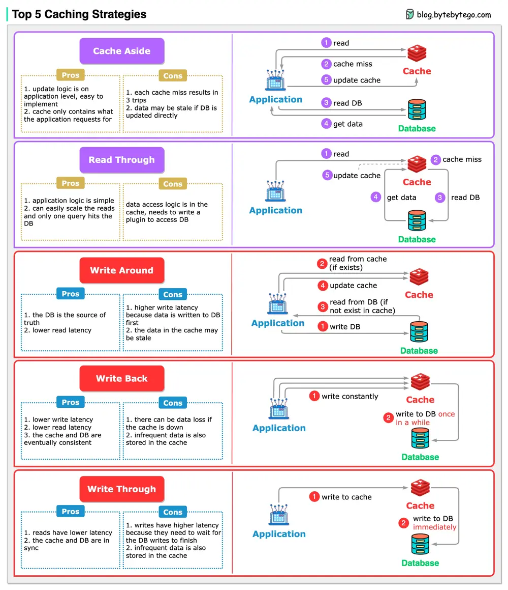

# ByteByteGo System Design 101: Top 5 Caching Strategies

> Copied from <https://github.com/ByteByteGoHq/system-design-101> (CC BY-NC-ND 4.0, by ByteByteGo). Questions and answers are the source's own; nothing was answered or rewritten here.

When we introduce a cache into the architecture, synchronization between the cache and the database becomes inevitable.

Let’s look at 5 common strategies for how we keep the data in sync.

## Read Strategies

*   Cache aside
*   Read through

## Write Strategies

*   Write around
*   Write back
*   Write through

The caching strategies are often used in combination. For example, write-around is often used together with cache-aside to make sure the cache is up-to-date.
