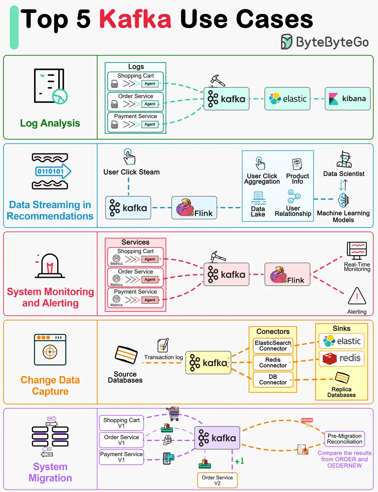

# ByteByteGo System Design 101: Top 5 Kafka Use Cases

> Copied from <https://github.com/ByteByteGoHq/system-design-101> (CC BY-NC-ND 4.0, by ByteByteGo). Questions and answers are the source's own; nothing was answered or rewritten here.

Kafka was originally built for massive log processing. It retains messages until expiration and lets consumers pull messages at their own pace.

Let’s review the popular Kafka use cases.

*   Log processing and analysis

*   Data streaming in recommendations

*   System monitoring and alerting

*   CDC (Change data capture)

*   System migration
