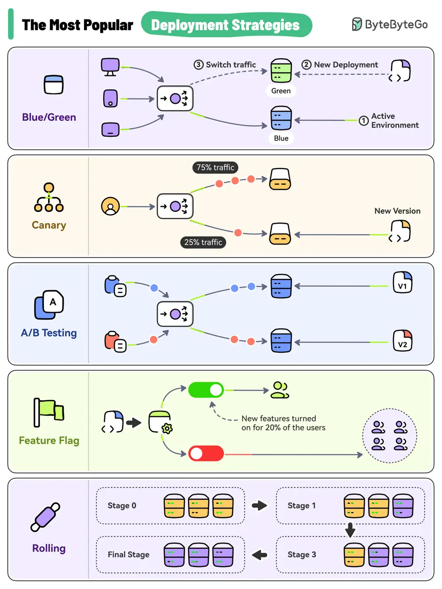

# ByteByteGo System Design 101: Top 5 Most-Used Deployment Strategies

> Copied from <https://github.com/ByteByteGoHq/system-design-101> (CC BY-NC-ND 4.0, by ByteByteGo). Questions and answers are the source's own; nothing was answered or rewritten here.

Here are the top 5 most-used deployment strategies:

*   **Big Bang Deployment**

*   **Rolling Deployment**

*   **Blue-Green Deployment**

*   **Canary Deployment**

*   **Feature Toggle**
