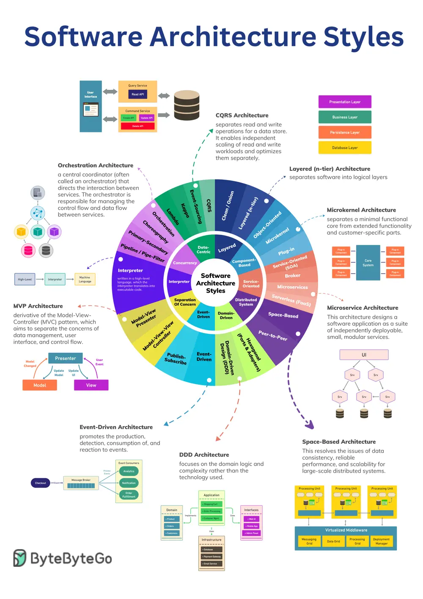

# ByteByteGo System Design 101: Top 5 Software Architectural Patterns

> Copied from <https://github.com/ByteByteGoHq/system-design-101> (CC BY-NC-ND 4.0, by ByteByteGo). Questions and answers are the source's own; nothing was answered or rewritten here.

In software development, architecture plays a crucial role in shaping the structure and behavior of software systems. It provides a blueprint for system design, detailing how components interact with each other to deliver specific functionality. They also offer solutions to common problems, saving time and effort and leading to more robust and maintainable systems.

However, with the vast array of architectural styles and patterns available, it can take time to discern which approach best suits a particular project or system. Aims to shed light on these concepts, helping you make informed decisions in your architectural endeavors.

To help you navigate the vast landscape of architectural styles and patterns, there is a cheat sheet that encapsulates all. This cheat sheet is a handy reference guide that you can use to quickly recall the main characteristics of each architectural style and pattern.
