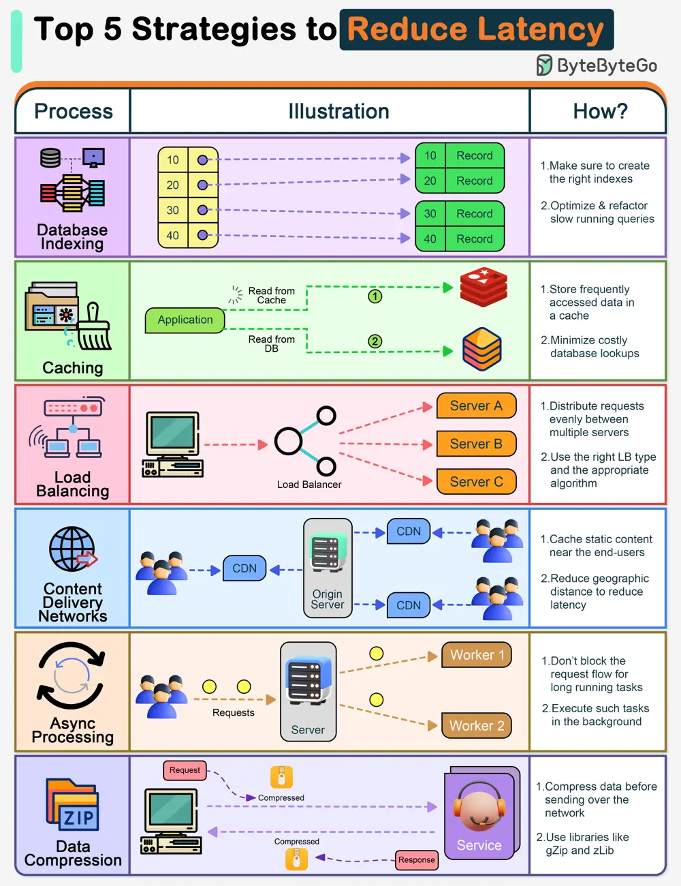

# ByteByteGo System Design 101: Top 5 Strategies to Reduce Latency

> Copied from <https://github.com/ByteByteGoHq/system-design-101> (CC BY-NC-ND 4.0, by ByteByteGo). Questions and answers are the source's own; nothing was answered or rewritten here.

10 years ago, Amazon found that every 100ms of latency cost them 1% in sales. That’s a staggering $5.7 billion in today’s terms.

For high-scale user-facing systems, high latency is a big loss of revenue.

Here are the top strategies to reduce latency:

*   **Database Indexing**
*   **Caching**
*   **Load Balancing**
*   **Content Delivery Network**
*   **Async Processing**
*   **Data Compression**
