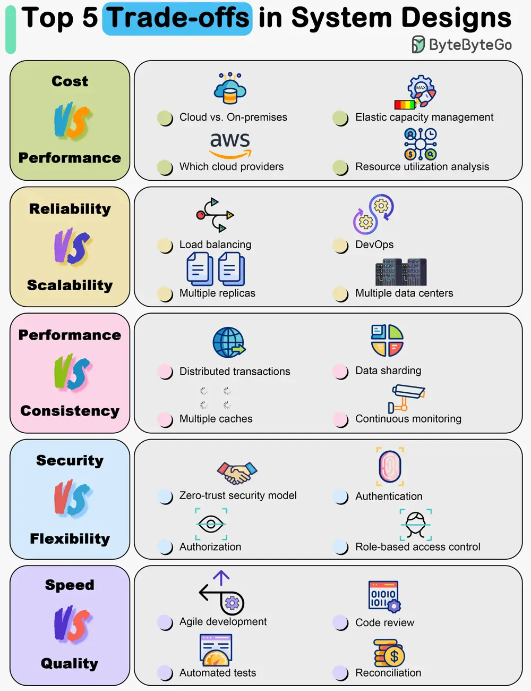

# ByteByteGo System Design 101: Top 5 Trade-offs in System Designs

> Copied from <https://github.com/ByteByteGoHq/system-design-101> (CC BY-NC-ND 4.0, by ByteByteGo). Questions and answers are the source's own; nothing was answered or rewritten here.

Everything is a trade-off. Everything is a compromise. There is no right or wrong design.

The diagram below shows some of the most important trade-offs.

*   **Cost vs. Performance**
*   **Reliability vs. Scalability**
*   **Performance vs. Consistency**
*   **Security vs. Flexibility**
*   **Development Speed vs. Quality**
