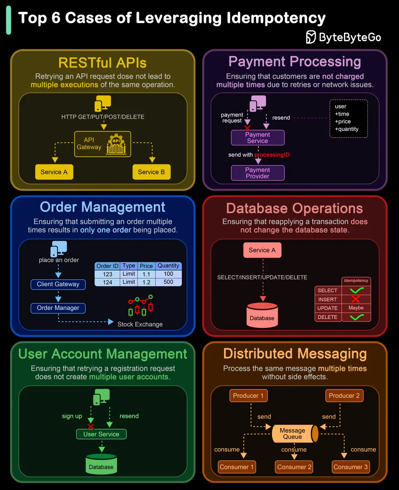

# ByteByteGo System Design 101: Top 6 Cases to Apply Idempotency

> Copied from <https://github.com/ByteByteGoHq/system-design-101> (CC BY-NC-ND 4.0, by ByteByteGo). Questions and answers are the source's own; nothing was answered or rewritten here.

Idempotency is essential in various scenarios, particularly where operations might be retried or executed multiple times. Here are the top 6 use cases where idempotency is crucial:

## 1. RESTful API Requests

We need to ensure that retrying an API request does not lead to multiple executions of the same operation. Implement idempotent methods (like PUT and DELETE) to maintain consistent resource states.

## 2. Payment Processing

We need to ensure that customers are not charged multiple times due to retries or network issues. Payment gateways often need to retry transactions; idempotency ensures only one charge is made.

## 3. Order Management Systems

We need to ensure that submitting an order multiple times results in only one order being placed. We design a safe mechanism to prevent duplicate inventory deductions or updates.

## 4. Database Operations

We need to ensure that reapplying a transaction does not change the database state beyond the initial application.

## 5. User Account Management

We need to ensure that retrying a registration request does not create multiple user accounts. Also, we need to ensure that multiple password reset requests result in a single reset action.

## 6. Distributed Systems and Messaging

We need to ensure that reprocessing messages from a queue does not result in duplicate processing. We Implement handlers that can process the same message multiple times without side effects.
