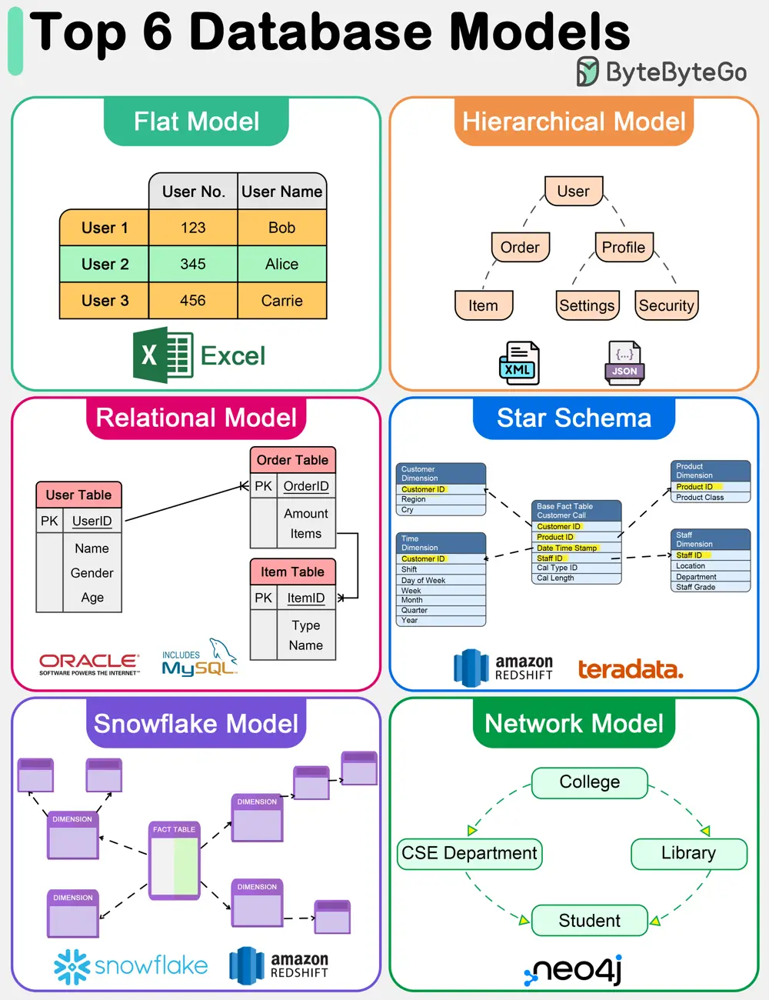

# ByteByteGo System Design 101: Top 6 Database Models

> Copied from <https://github.com/ByteByteGoHq/system-design-101> (CC BY-NC-ND 4.0, by ByteByteGo). Questions and answers are the source's own; nothing was answered or rewritten here.

The diagram above shows top 6 data models.

*   **Flat Model**

    The flat data model is one of the simplest forms of database models. It organizes data into a single table where each row represents a record and each column represents an attribute. This model is similar to a spreadsheet and is straightforward to understand and implement. However, it lacks the ability to efficiently handle complex relationships between data entities.

*   **Hierarchical Model**

    The hierarchical data model organizes data into a tree-like structure, where each record has a single parent but can have multiple children. This model is efficient for scenarios with a clear "parent-child" relationship among data entities. However, it struggles with many-to-many relationships and can become complex and rigid.

*   **Relational Model**

    Introduced by E.F. Codd in 1970, the relational model represents data in tables (relations), consisting of rows (tuples) and columns (attributes). It supports data integrity and avoids redundancy through the use of keys and normalization. The relational model's strength lies in its flexibility and the simplicity of its query language, SQL (Structured Query Language), making it the most widely used data model for traditional database systems. It efficiently handles many-to-many relationships and supports complex queries and transactions.

*   **Star Schema**

    The star schema is a specialized data model used in data warehousing for OLAP (Online Analytical Processing) applications. It features a central fact table that contains measurable, quantitative data, surrounded by dimension tables that contain descriptive attributes related to the fact data. This model is optimized for query performance in analytical applications, offering simplicity and fast data retrieval by minimizing the number of joins needed for queries.

*   **Snowflake Model**

    The snowflake model is a variation of the star schema where the dimension tables are normalized into multiple related tables, reducing redundancy and improving data integrity. This results in a structure that resembles a snowflake. While the snowflake model can lead to more complex queries due to the increased number of joins, it offers benefits in terms of storage efficiency and can be advantageous in scenarios where dimension tables are large or frequently updated.

*   **Network Model**

    The network data model allows each record to have multiple parents and children, forming a graph structure that can represent complex relationships between data entities. This model overcomes some of the hierarchical model's limitations by efficiently handling many-to-many relationships.
