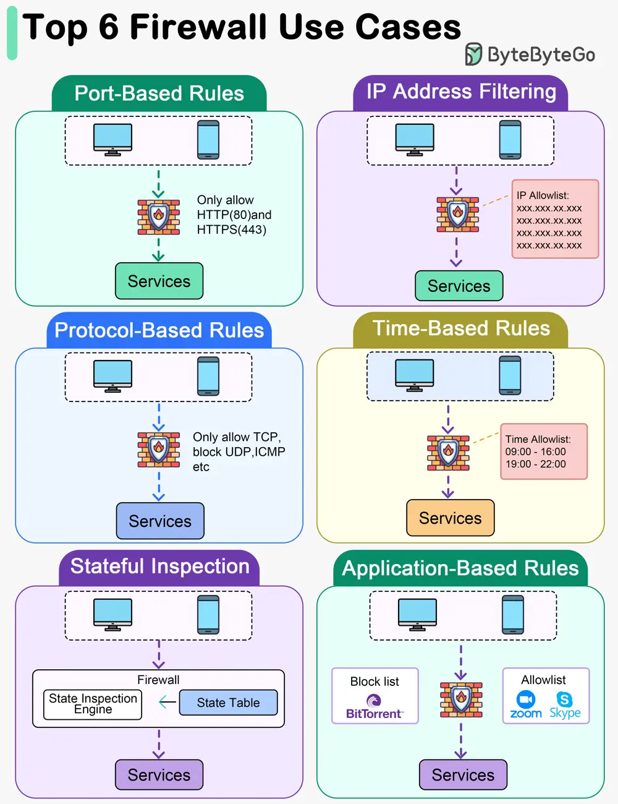

# ByteByteGo System Design 101: Top 6 Firewall Use Cases

> Copied from <https://github.com/ByteByteGoHq/system-design-101> (CC BY-NC-ND 4.0, by ByteByteGo). Questions and answers are the source's own; nothing was answered or rewritten here.

## Port-Based Rules

Firewall rules can be set to allow or block traffic based on specific ports. For example, allowing only traffic on ports 80 (HTTP) and 443 (HTTPS) for web browsing.

## IP Address Filtering

Rules can be configured to allow or deny traffic based on source or destination IP addresses. This can include whitelisting trusted IP addresses or blacklisting known malicious ones.

## Protocol-Based Rules

Firewalls can be configured to allow or block traffic based on specific network protocols such as TCP, UDP, ICMP, etc. For instance, allowing only TCP traffic on port 22 (SSH).

## Time-Based Rules

Firewalls can be configured to enforce rules based on specific times or schedules. This can be useful for setting different access rules during business hours versus after-hours.

## Stateful Inspection

**Stateful Inspection:** Stateful firewalls monitor the state of active connections and allow traffic only if it matches an established connection, preventing unauthorized access from the outside.

## Application-Based Rules

Some firewalls offer application-level control by allowing or blocking traffic based on specific applications or services. For instance, allowing or restricting access to certain applications like Skype, BitTorrent, etc.
