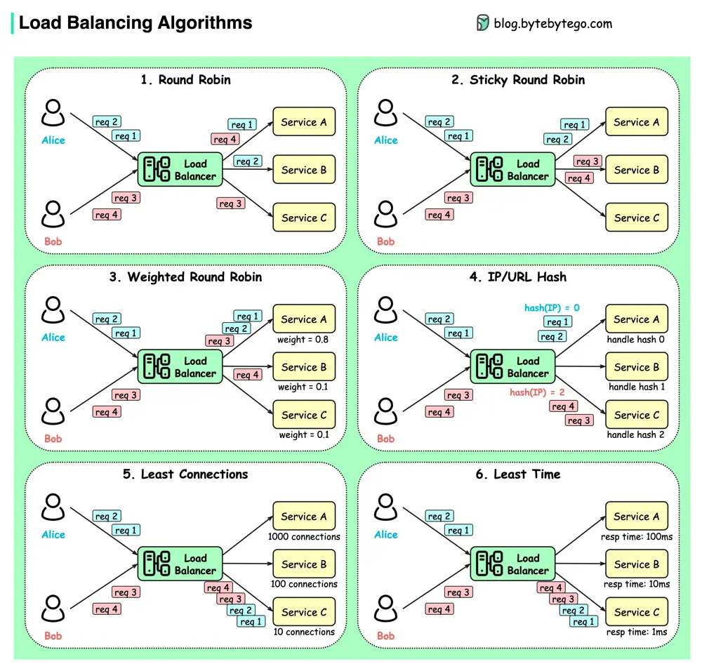

# ByteByteGo System Design 101: Top 6 Load Balancing Algorithms

> Copied from <https://github.com/ByteByteGoHq/system-design-101> (CC BY-NC-ND 4.0, by ByteByteGo). Questions and answers are the source's own; nothing was answered or rewritten here.

## Top 6 Load Balancing Algorithms

*   **Static Algorithms**

    *   Round robin

        The client requests are sent to different service instances in sequential order. The services are usually required to be stateless.

    *   Sticky round-robin

        This is an improvement of the round-robin algorithm. If Alice’s first request goes to service A, the following requests go to service A as well.

    *   Weighted round-robin

        The admin can specify the weight for each service. The ones with a higher weight handle more requests than others.

    *   Hash

        This algorithm applies a hash function on the incoming requests’ IP or URL. The requests are routed to relevant instances based on the hash function result.

*   **Dynamic Algorithms**

    *   Least connections

        A new request is sent to the service instance with the least concurrent connections.

    *   Least response time

        A new request is sent to the service instance with the fastest response time.
