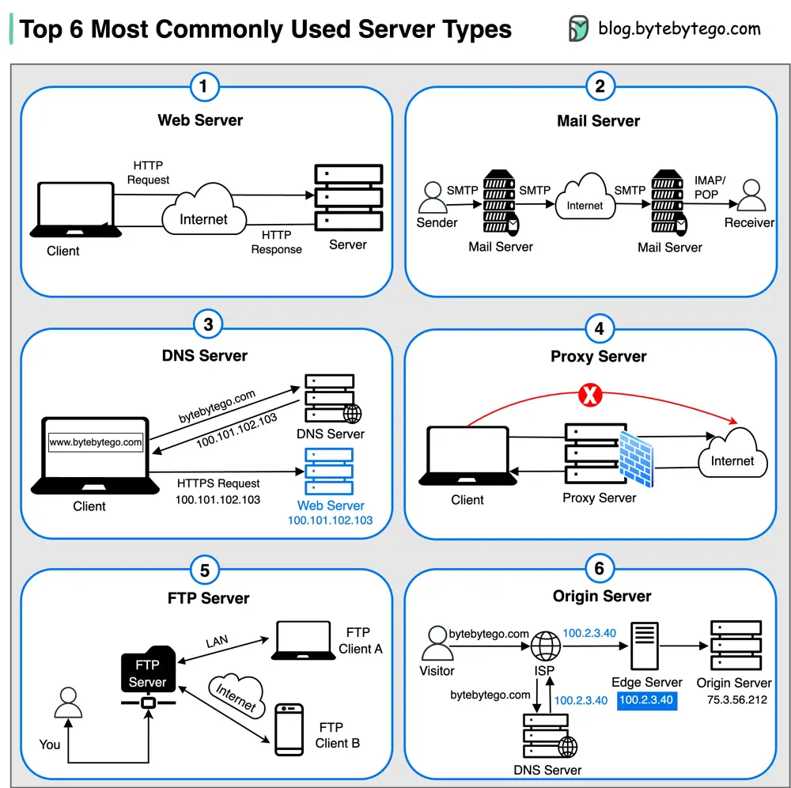

# ByteByteGo System Design 101: Top 6 Most Commonly Used Server Types

> Copied from <https://github.com/ByteByteGoHq/system-design-101> (CC BY-NC-ND 4.0, by ByteByteGo). Questions and answers are the source's own; nothing was answered or rewritten here.

## 1. Web Server

Hosts websites and delivers web content to clients over the internet.

## 2. Mail Server

Handles the sending, receiving, and routing of emails across networks.

## 3. DNS Server

Translates domain names (like bytebytego.com) into IP addresses, enabling users to access websites by their human-readable names.

## 4. Proxy Server

An intermediary server that acts as a gateway between clients and other servers, providing additional security, performance optimization, and anonymity.

## 5. FTP Server

Facilitates the transfer of files between clients and servers over a network.

## 6. Origin Server

Hosts central source of content that is cached and distributed to edge servers for faster delivery to end users.
