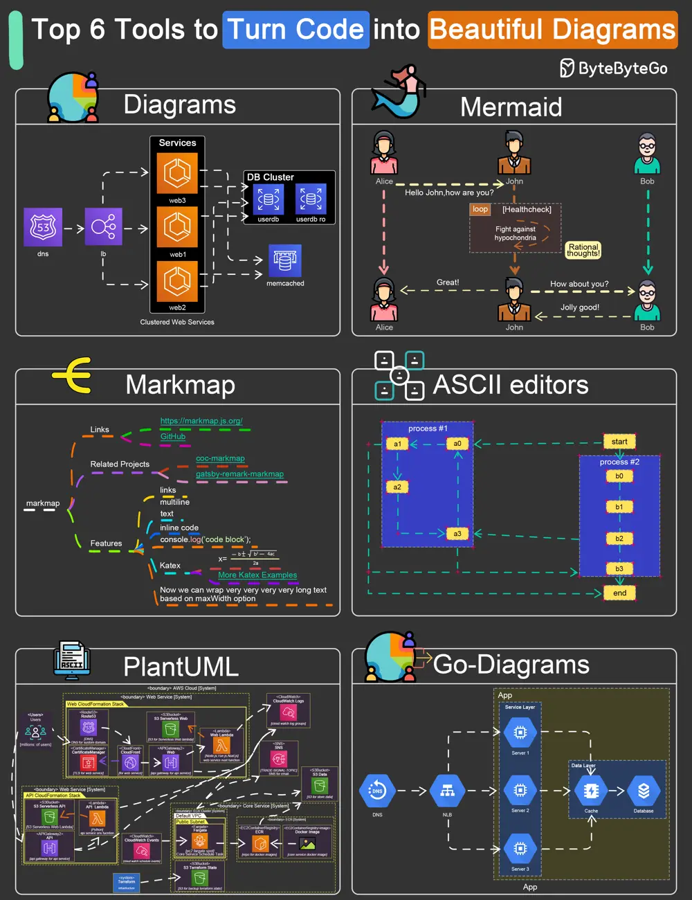

# ByteByteGo System Design 101: Top 6 Tools to Turn Code into Beautiful Diagrams

> Copied from <https://github.com/ByteByteGoHq/system-design-101> (CC BY-NC-ND 4.0, by ByteByteGo). Questions and answers are the source's own; nothing was answered or rewritten here.

Here are the top tools to turn code into diagrams:

*   Diagrams
*   Go Diagrams
*   Mermaid
*   PlantUML
*   ASCII diagrams
*   Markmap
