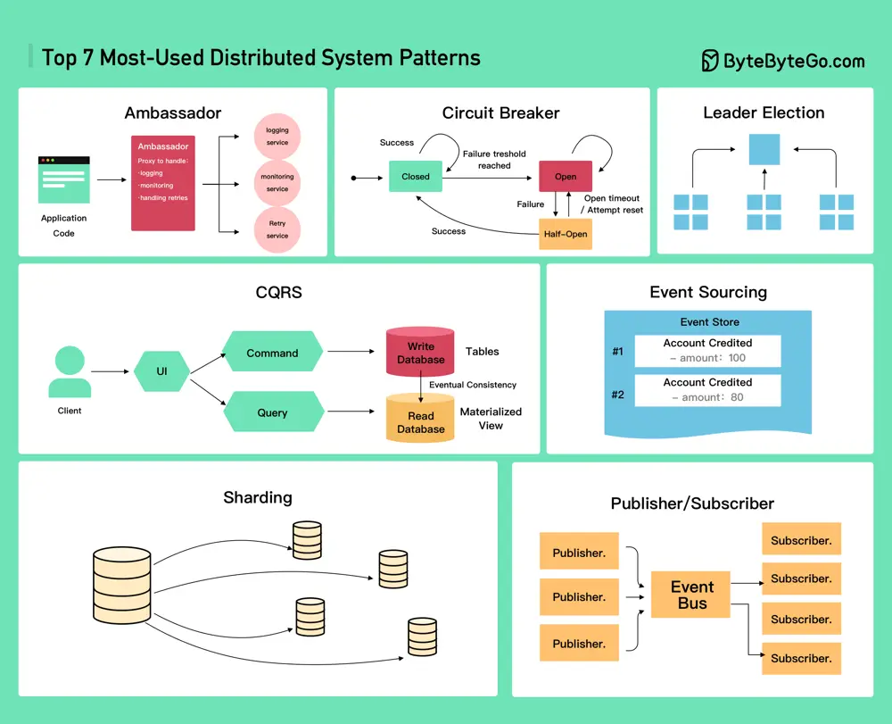

# ByteByteGo System Design 101: Top 7 Most-Used Distributed System Patterns

> Copied from <https://github.com/ByteByteGoHq/system-design-101> (CC BY-NC-ND 4.0, by ByteByteGo). Questions and answers are the source's own; nothing was answered or rewritten here.

* Ambassador
* Circuit Breaker
* CQRS
* Event Sourcing
* Leader Election
* Publisher/Subscriber
* Sharding
