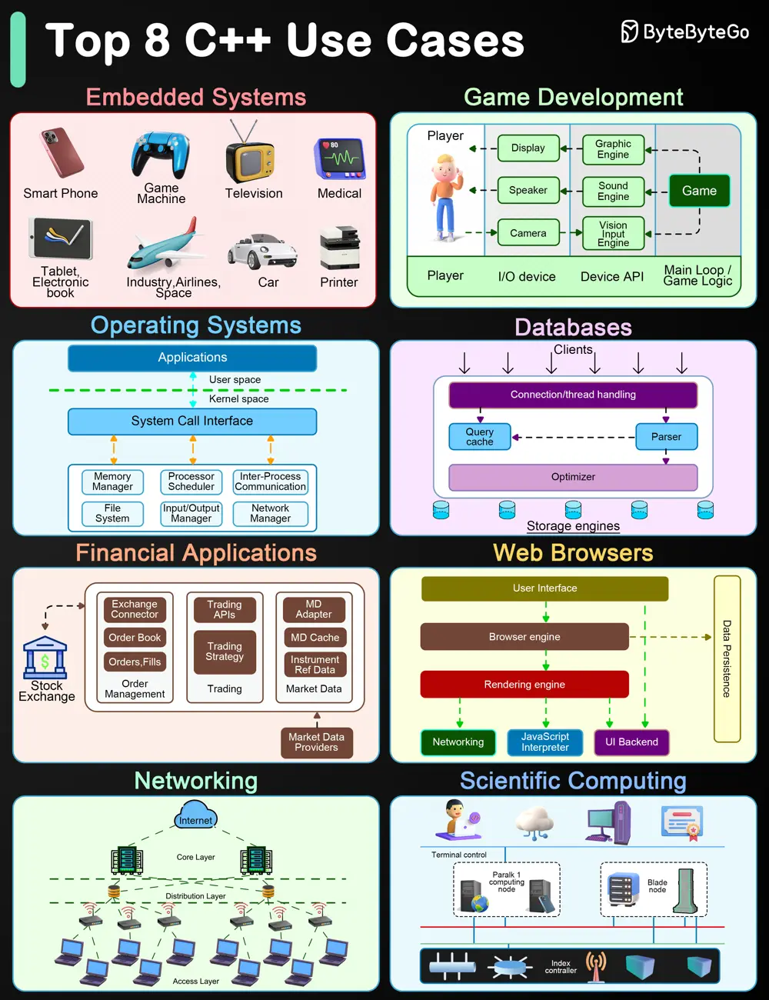

# ByteByteGo System Design 101: Top 8 C++ Use Cases

> Copied from <https://github.com/ByteByteGoHq/system-design-101> (CC BY-NC-ND 4.0, by ByteByteGo). Questions and answers are the source's own; nothing was answered or rewritten here.

C++ is a highly versatile programming language that is suitable for a wide range of applications.

## Embedded Systems

*   The language's efficiency and fine control over hardware resources make it excellent for embedded systems development.

## Game Development

*   C++ is a staple in the game development industry due to its performance and efficiency.

## Operating Systems

*   C++ provides extensive control over system resources and memory, making it ideal for developing operating systems and low-level system utilities.

## Databases

*   Many high-performance database systems are implemented in C++ to manage memory efficiently and ensure fast execution of queries.

## Financial Applications

## Web Browsers

*   C++ is used in the development of web browsers and their components, such as rendering engines.

## Networking

*   C++ is often used for developing network devices and simulation tools.

## Scientific Computing

*   C++ finds extensive use in scientific computing and engineering applications that require high performance and precise control over computational resources.
