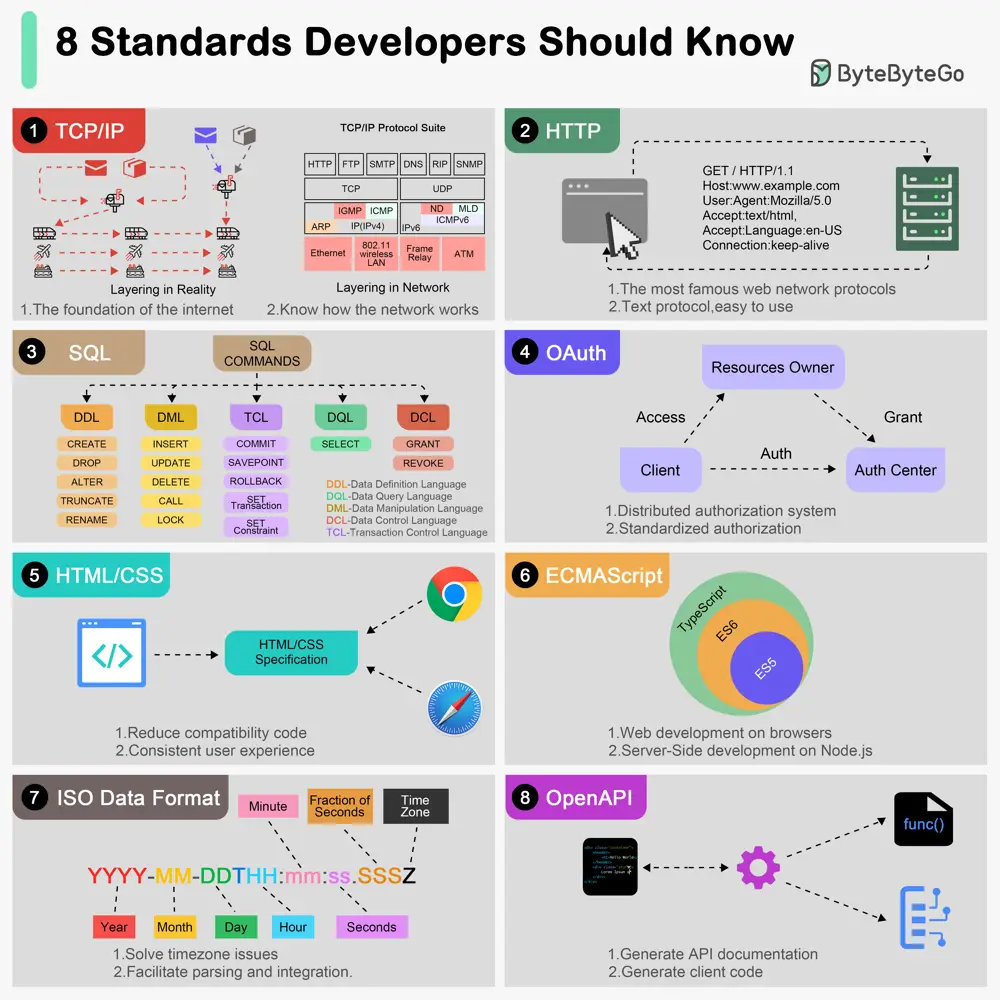

# ByteByteGo System Design 101: Top 8 Standards Every Developer Should Know

> Copied from <https://github.com/ByteByteGoHq/system-design-101> (CC BY-NC-ND 4.0, by ByteByteGo). Questions and answers are the source's own; nothing was answered or rewritten here.

## TCP/IP

Developed by the IETF organization, the TCP/IP protocol is the foundation of the Internet and one of the best-known networking standards.

## HTTP

The IETF has also developed the HTTP protocol, which is essential for all web developers.

## SQL

Structured Query Language (SQL) is a domain-specific language used to manage data.

## OAuth

OAuth (Open Authorization) is an open standard for access delegation commonly used to grant websites or applications limited access to user information without exposing their passwords.

## HTML/CSS

With HTML, web pages are rendered uniformly across browsers, which reduces development effort spent on compatibility issues.HTML tags.

CSS standards are often used in conjunction with HTML.

## ECMAScript

ECMAScript is a standardized scripting language specification that serves as the foundation for several programming languages, the most well-known being JavaScript.

## ISO Date

It is common for developers to have problems with inconsistent time formats on a daily basis. ISO 8601 is a date and time format standard developed by the ISO (International Organization for Standardization) to provide a common format for exchanging date and time data across borders, cultures, and industries.

## OpenAPI

OpenAPI, also known as the OpenAPI Specification (OAS), is a standardized format for describing and documenting RESTful APIs.
