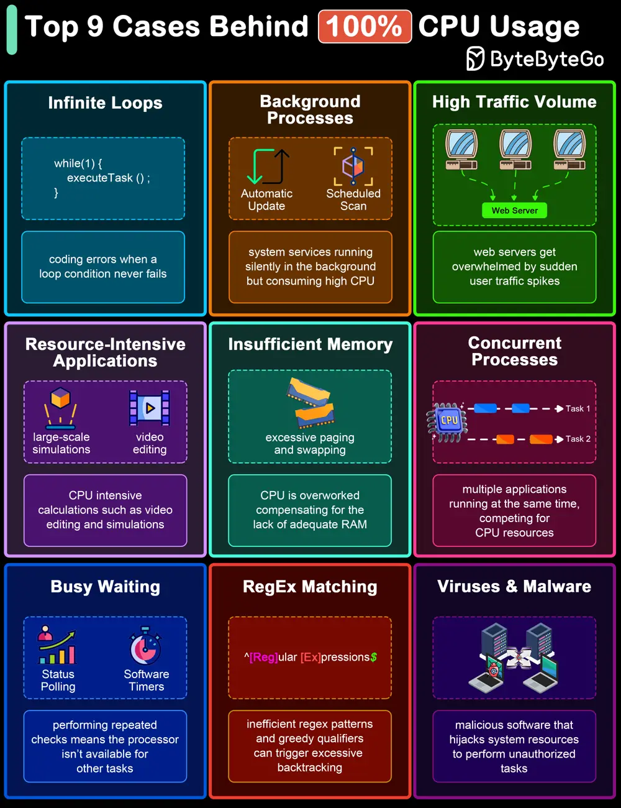

# ByteByteGo System Design 101: Top 9 Causes of 100% CPU Usage

> Copied from <https://github.com/ByteByteGoHq/system-design-101> (CC BY-NC-ND 4.0, by ByteByteGo). Questions and answers are the source's own; nothing was answered or rewritten here.

The diagram below shows common culprits that can lead to 100% CPU usage. Understanding these can help in diagnosing problems and improving system efficiency.

## Top 9 Causes of 100% CPU Usage

*   Infinite Loops
*   Background Processes
*   High Traffic Volume
*   Resource-Intensive Applications
*   Insufficient Memory
*   Concurrent Processes
*   Busy Waiting
*   Regular Expression Matching
*   Malware and Viruses
