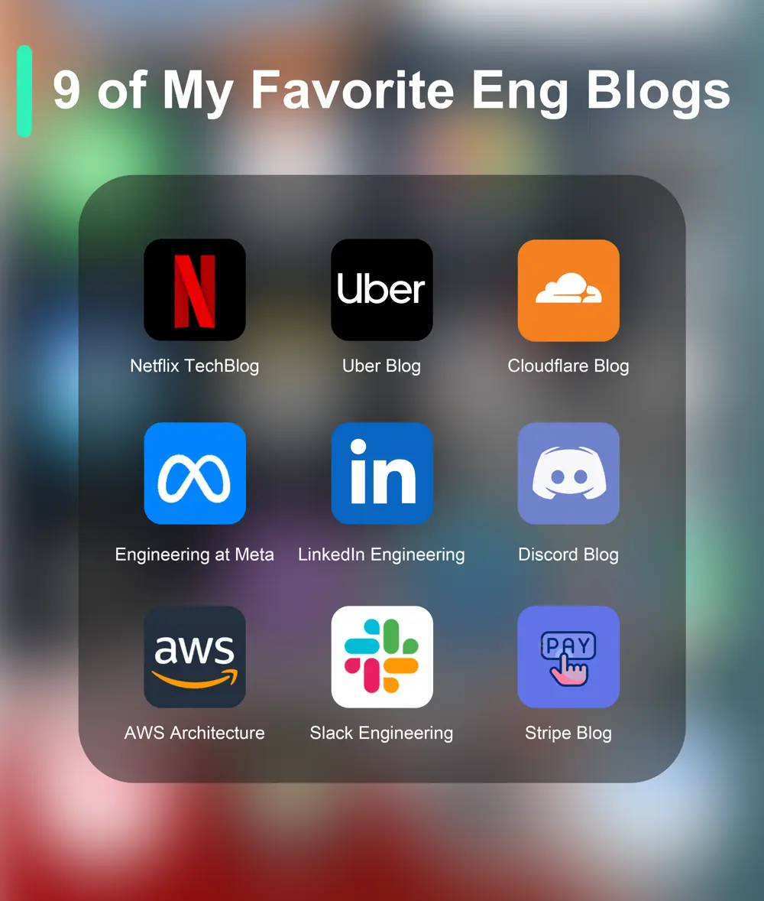

# ByteByteGo System Design 101: Top 9 Engineering Blogs

> Copied from <https://github.com/ByteByteGoHq/system-design-101> (CC BY-NC-ND 4.0, by ByteByteGo). Questions and answers are the source's own; nothing was answered or rewritten here.

There are over 1,000 engineering blogs. Here are my top 9 favorites:

*   Netflix TechBlog
*   Uber Blog
*   Cloudflare Blog
*   Engineering at Meta
*   LinkedIn Engineering
*   Discord Blog
*   AWS Architecture
*   Slack Engineering
*   Stripe Blog
