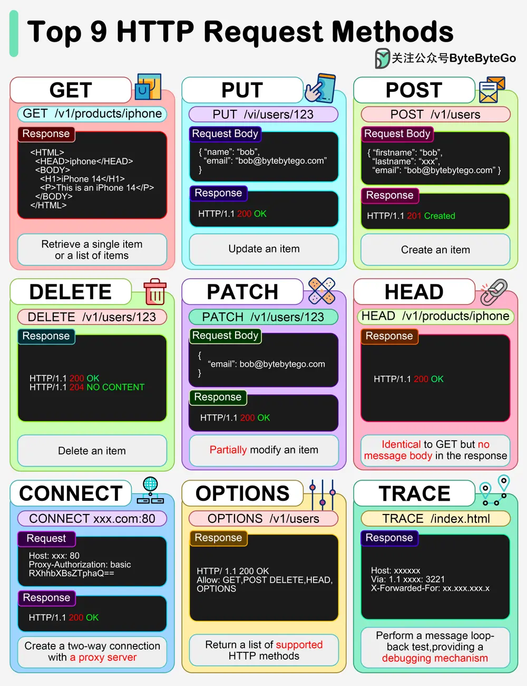

# ByteByteGo System Design 101: Top 9 HTTP Request Methods

> Copied from <https://github.com/ByteByteGoHq/system-design-101> (CC BY-NC-ND 4.0, by ByteByteGo). Questions and answers are the source's own; nothing was answered or rewritten here.

GET, POST, PUT... Common HTTP “verbs” in one figure.

*   **HTTP GET**

    This retrieves a resource from the server. It is idempotent. Multiple identical requests return the same result.
*   **HTTP PUT**

    This updates or Creates a resource. It is idempotent. Multiple identical requests will update the same resource.
*   **HTTP POST**

    This is used to create new resources. It is not idempotent, making two identical POST will duplicate the resource creation.
*   **HTTP DELETE**

    This is used to delete a resource. It is idempotent. Multiple identical requests will delete the same resource.
*   **HTTP PATCH**

    The PATCH method applies partial modifications to a resource.
*   **HTTP HEAD**

    The HEAD method asks for a response identical to a GET request but without the response body.
*   **HTTP CONNECT**

    The CONNECT method establishes a tunnel to the server identified by the target resource.
*   **HTTP OPTIONS**

    This describes the communication options for the target resource.
*   **HTTP TRACE**

    This performs a message loop-back test along the path to the target resource.
