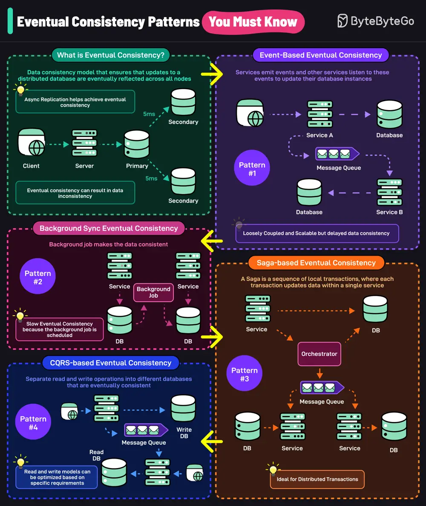

# ByteByteGo System Design 101: Top Eventual Consistency Patterns You Must Know

> Copied from <https://github.com/ByteByteGoHq/system-design-101> (CC BY-NC-ND 4.0, by ByteByteGo). Questions and answers are the source's own; nothing was answered or rewritten here.

Eventual consistency is a data consistency model that ensures that updates to a distributed database are eventually reflected across all nodes. Techniques like async replication help achieve eventual consistency.

However, eventual consistency can also result in data inconsistency. Here are 4 patterns that can help you design applications.

## Event-based Eventual Consistency

Services emit events and other services listen to these events to update their database instances. This makes services loosely coupled but delays data consistency.

## Background Sync Eventual Consistency

In this pattern, a background job makes the data across databases consistent. It results in slower eventual consistency since the background job runs on a specific schedule.

## Saga-based Eventual Consistency

Saga is a sequence of local transactions where each transaction updates data with a single service. It is used to manage long-lived transactions that are eventually consistent.

## CQRS-based Eventual Consistency

Separate read and write operations into different databases that are eventually consistent. Read and write models can be optimized for specific requirements.
