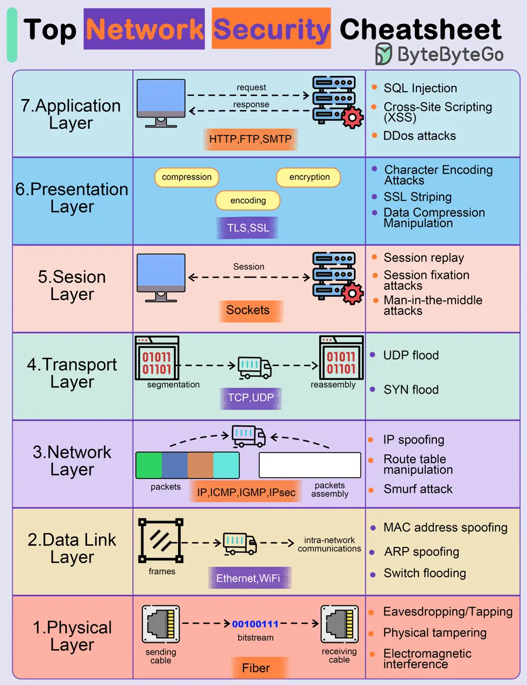

# ByteByteGo System Design 101: Top Network Security Cheatsheet

> Copied from <https://github.com/ByteByteGoHq/system-design-101> (CC BY-NC-ND 4.0, by ByteByteGo). Questions and answers are the source's own; nothing was answered or rewritten here.

The diagram below shows some possible network attacks in 7 OSI model layers.

## Application Layer

*   Pushing
*   Malware injection
*   DDoS attacks

## Presentation Layer

*   Encoding/decoding vulnerabilities
*   Format string attacks
*   Malicious code injection

## Session Layer

*   Session hijacking
*   Session fixation attacks
*   Brute force attacks

## Transport Layer

*   Man-in-the-middle attacks
*   SYN/ACK flood

## Network Layer

*   IP spoofing
*   Route table manipulation
*   DDoS attacks

## Data Link Layer

*   MAC address spoofing
*   ARP spoofing
*   VLAN hopping

## Physical Layer

*   Wiretapping
*   Physical tampering
*   Electromagnetic interference
