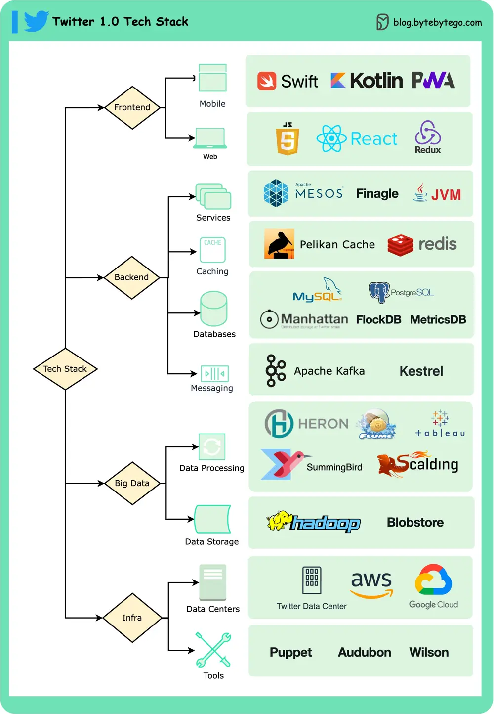

# ByteByteGo System Design 101: Twitter 1.0 Tech Stack

> Copied from <https://github.com/ByteByteGoHq/system-design-101> (CC BY-NC-ND 4.0, by ByteByteGo). Questions and answers are the source's own; nothing was answered or rewritten here.

*   **Mobile:** Swift, Kotlin, PWA
*   **Web:** JS, React, Redux
*   **Services:** Mesos, Finagle
*   **Caching:** Pelikan Cache, Redis
*   **Databases:** Manhattan, MySQL, PostgreSQL
