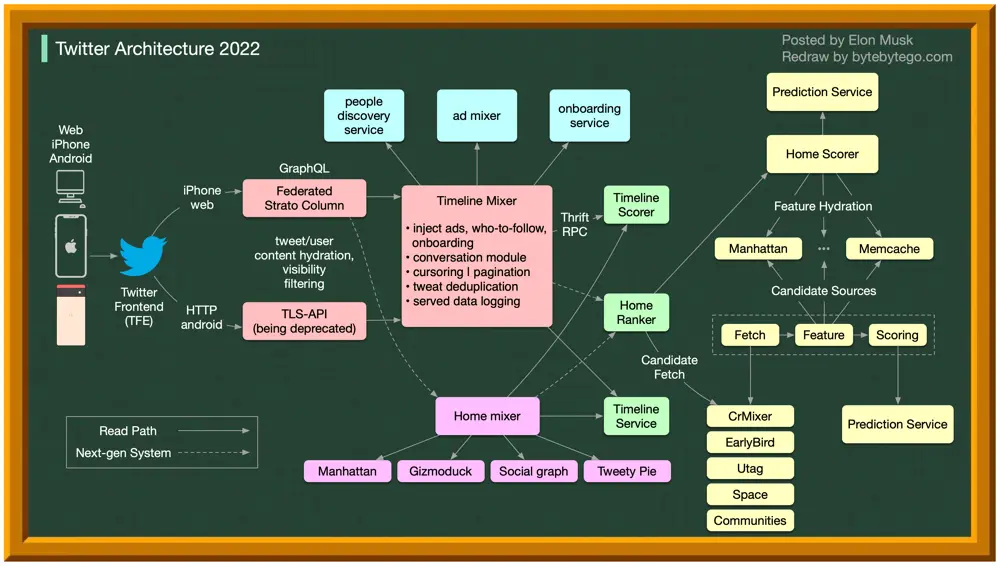

# ByteByteGo System Design 101: Twitter Architecture 2022 vs. 2012

> Copied from <https://github.com/ByteByteGoHq/system-design-101> (CC BY-NC-ND 4.0, by ByteByteGo). Questions and answers are the source's own; nothing was answered or rewritten here.

What’s changed over the past 10 years?!
