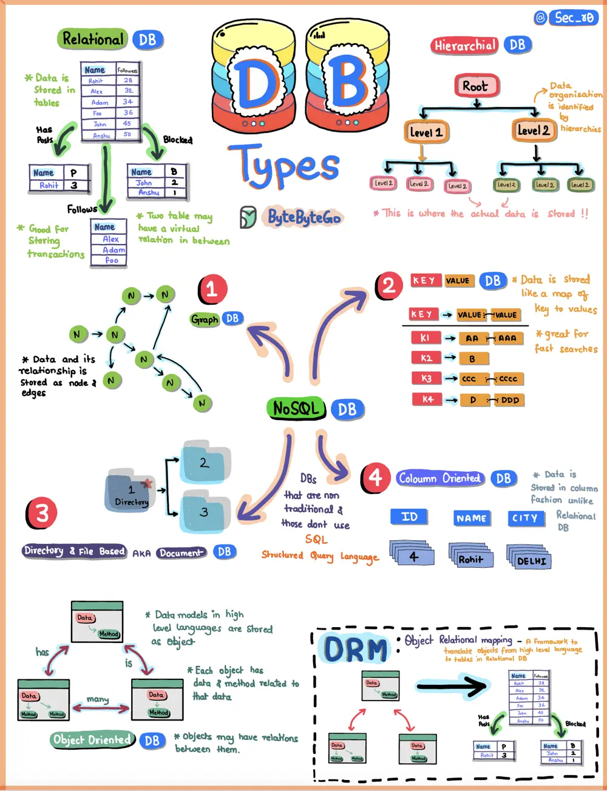

# ByteByteGo System Design 101: Types of Databases

> Copied from <https://github.com/ByteByteGoHq/system-design-101> (CC BY-NC-ND 4.0, by ByteByteGo). Questions and answers are the source's own; nothing was answered or rewritten here.

What is a database? What are some common types of databases?

First off, what's a database? Think of it as a digital playground where we organize and store loads of information in a structured manner. Now, let's shake things up and look at the main types of databases.

## Relational DB

Imagine it's like organizing data in neat tables. Think of it as the well-behaved sibling, keeping everything in order.

## OLAP DB

Online Analytical Processing (OLAP) is a technology optimized for reporting and analysis purposes.

## NoSQL DBs

These rebels have their own cool club, saying "No" to traditional SQL ways. NoSQL databases come in four exciting flavors:

*   **Graph DB:** Think of social networks, where relationships between people matter most. It's like mapping who's friends with whom.

*   **Key-value Store DB:** It's like a treasure chest, with each item having its unique key. Finding what you need is a piece of cake.

*   **Document DB:** A document database is a kind of database that stores information in a format similar to JSON. It's different from traditional databases and is made for working with documents instead of tables.

*   **Column DB:** Imagine slicing and dicing your data like a chef prepping ingredients. It's efficient and speedy.
