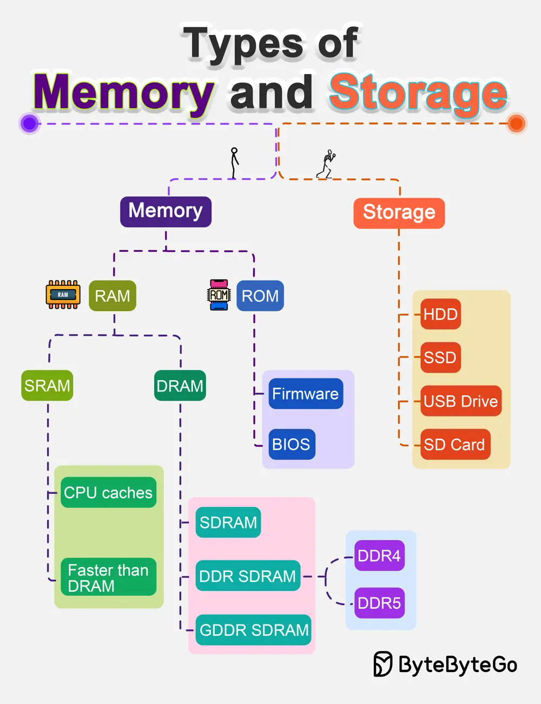

# ByteByteGo System Design 101: Types of Memory and Storage

> Copied from <https://github.com/ByteByteGoHq/system-design-101> (CC BY-NC-ND 4.0, by ByteByteGo). Questions and answers are the source's own; nothing was answered or rewritten here.

Diving into the world of computer memory and storage.

*   The fundamental duo: RAM and ROM
*   DDR4 and DDR5
*   Firmware and BIOS
*   SRAM and DRAM
*   HDD, SSD, USB Drive, SD Card
*   and more
