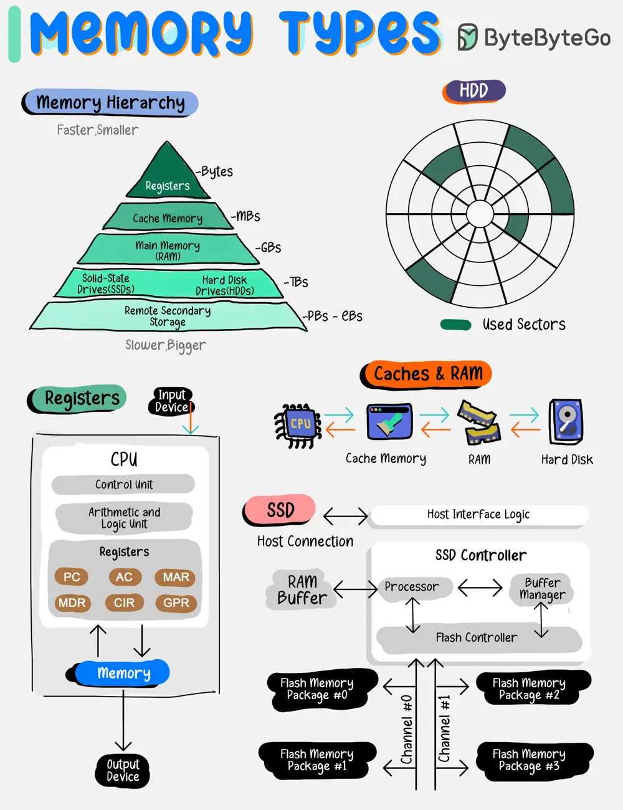

# ByteByteGo System Design 101: Types of Memory

> Copied from <https://github.com/ByteByteGoHq/system-design-101> (CC BY-NC-ND 4.0, by ByteByteGo). Questions and answers are the source's own; nothing was answered or rewritten here.

Memory types vary by speed, size, and function, creating a multi-layered architecture that balances cost with the need for rapid data access.

By grasping the roles and capabilities of each memory type, developers and system architects can design systems that effectively leverage the strengths of each storage layer, leading to improved overall system performance and user experience.

Some of the common Memory types are:

*   **Registers:** Tiny, ultra-fast storage within the CPU for immediate data access.

*   **Caches:** Small, quick memory located close to the CPU to speed up data retrieval.

*   **Main Memory (RAM):** Larger, primary storage for currently executing programs and data.

*   **Solid-State Drives (SSDs):** Fast, reliable storage with no moving parts, used for persistent data.

*   **Hard Disk Drives (HDDs):** Mechanical drives with large capacities for long-term storage.

*   **Remote Secondary Storage:** Offsite storage for data backup and archiving, accessible over a network.
