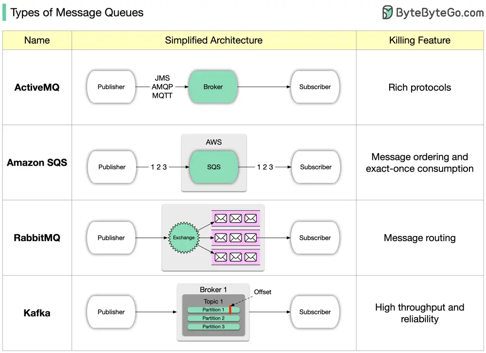

# ByteByteGo System Design 101: Types of Message Queues

> Copied from <https://github.com/ByteByteGoHq/system-design-101> (CC BY-NC-ND 4.0, by ByteByteGo). Questions and answers are the source's own; nothing was answered or rewritten here.

### How many message queues do you know?

Like a post office, a message queue helps computer programs communicate in an organized manner. Imagine little digital envelopes being passed around to keep everything on track. There are a few key features to consider when selecting message queues:

*   Speed: How fast messages are sent and received

*   Scalability: Can it grow with more messages

*   Reliability: Will it make sure messages don’t get lost

*   Durability: Can it keep messages safe over time

*   Ease of Use: Is it simple to set up and manage

*   Ecosystem: Are there helpful tools available

*   Integration: Can it play nice with other software

*   Protocol Support: What languages can it speak

Try out a message queue and practice sending and receiving messages until you're comfortable. Choose an easy one like Kafka and experiment with sending and receiving messages. Read books or take online courses as you get more comfortable. Build little projects and learn from those who have already been there. Soon, you'll know everything about message queues.
